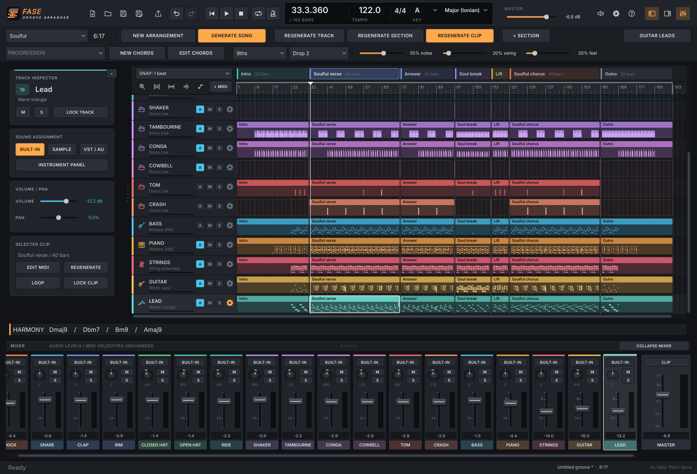

<p align="center"></p>

<h1 align="center">Fase Groove Arranger</h1>

<p align="center">
  <b>A standalone MIDI arranging workstation for the Fase Groove ecosystem.</b><br>
  by <b>Fabio 'Pitch' Serra</b> · Windows, macOS &amp; Linux · free and open source
</p>

<p align="center"><b>🇬🇧 English</b> · <a href="README.it.md">🇮🇹 Italiano</a></p>

<p align="center">
  <a href="docs/GUIDE.md"><b>📖 User guide</b></a> ·
  <a href="CHANGELOG.md">🆕 What's new</a> ·
  <a href="#build-and-run">⬇️ Build and download</a> ·
  <a href="#ecosystem">☕ Support the project</a> ·
  <a href="PRIVACY.md">Privacy</a> · <a href="LICENSE">License</a>
</p>

---

**Development build: 0.4.3** — [PR #1](https://github.com/wsx79/fasegroovearranger/pull/1). This is not a published release.

Create a complete song with the original Piano, Drums and Guitar engines: Intro → Main → Breakdown → Build-up → Drop → Outro. Choose one of the same 13 genres, edit the generated notes, assign sounds per track, and export the mix or individual stems.

By **Fabio 'Pitch' Serra / FS Pitch — DJ & Producer**. Development assistance: **Claude (Anthropic)** and **Codex (OpenAI)**. Free software under **AGPL-3.0-or-later**.



## What is implemented

- The original, vendored C++ generation engines run inside the application; no Fase Groove plugin installation is required.
- 17 tracks in musical order: Kick, Snare, Clap, Rim, Closed Hat, Open Hat, Ride, Shaker, Tambourine, Conga, Cowbell, Tom, Crash, Bass, Piano, Strings and Guitar.
- The guitar stays together as one instrument, preserving its playing lanes internally.
- Full-song, single-track, single-section and single-clip generation, deterministic stored takes, track/clip generation locks, and 40-step undo/redo.
- Genre-specific forms whose length follows the groove and complete harmonic phrases. Musical intro/outro development uses the original engines, without a fixed duration target or forced silent harmonic windows.
- Six musical section types, duplication, ordering, renaming and adjustable bar lengths.
- Key, 13 scales, chord progression library, chord colour, voicing, bass/strings patterns, tempo, density, swing and humanisation.
- Separate instrument panels and large MIDI editors, isolated drum lanes, all guitar lanes together, original guitar-soloist/piano-comping logic, and per-instrument generation settings.
- Editable piano roll: draw, move, resize, delete, change velocity, select multiple notes, quantise, transpose and copy/paste. Import standard PPQ MIDI into a selected clip.
- Native audio playback, seeking and song/section loops; per-track gain, pan, mute, solo and meters; master level.
- Original synthesized guide sounds, user audio samples with adjustable root note, and one native VST3 instrument per track (Audio Units also on macOS). Plugin editor and state persistence.
- Project files (`.fga`), atomic saves, periodic local autosave and missing-instrument relinking.
- Multitrack MIDI and individual MIDI files; stereo 24-bit WAV and 320 kbps stereo MP3, for a mix, one track or all 17 stems. **The MP3 encoder is bundled.**
- Six original interface languages (English, Italian, Spanish, French, German and Portuguese), translated control tooltips with a saved on/off preference, and extended piano controls including step dynamics, inversions, independent riff/feel seeds and sustain/expression MIDI controllers.
- Original piano DNA, Morph, Voicing Coach A/B, Chord Variation Lab and circle of fifths; MIDI harmony/rhythm analysis, opt-in keyboard chord learning and local track presets. Shared half/one/two/four-bar harmonic duration; guide-sound pump rate and tempo/Kick-MIDI source.
- Family SETTINGS / ABOUT overlay, interface-size preference, optional GitHub release checks and the original family icon buttons.
- Italian/English Markdown guides, in-app privacy/permissions and the original ecosystem's credits, artist logo and links.

## Build and run

Requires CMake 3.22+, a C++17 compiler, and JUCE **8.0.9** (automatically fetched at build time, or supplied locally with `-DJUCE_DIR=/path/to/JUCE`). The runtime works offline.

```sh
cmake -S . -B build -DCMAKE_BUILD_TYPE=Release
cmake --build build --config Release -j2
ctest --test-dir build -C Release --output-on-failure
```

The standalone application is in `build/FaseGrooveArranger_artefacts/Release/`. Open the application bundle on macOS or the executable on Windows/Linux. This is a **desktop application**, not a website or an embedded web view.

On Ubuntu/Debian install the native development dependencies first:

```sh
sudo apt-get install build-essential cmake libasound2-dev libx11-dev libxext-dev libxinerama-dev libxrandr-dev libxcursor-dev libfreetype6-dev libfontconfig1-dev libgl1-mesa-dev
```

GitHub Actions builds Windows, macOS and Linux packages and runs the tests. Download successful builds from the workflow's **Artifacts** panel, then extract the distribution archive inside it: Windows `.zip`; macOS/Linux `.tar.gz`. The Unix archives preserve executable permissions. macOS binaries are universal (Apple Silicon + Intel); Windows bundles its C/C++ runtime statically. Development artifacts are unsigned; release signing/notarisation and installers are not configured.

Distribution targets: Windows 10+, macOS 11+ and Ubuntu 24.04-compatible Linux systems. Build from source for other Linux distributions. Actual external plugins may require a newer OS.

For the portable arranging and MP3 engines alone:

```sh
cmake -S . -B build-core -DFGA_BUILD_APP=OFF
cmake --build build-core -j2
ctest --test-dir build-core --output-on-failure
```

Without CMake, `bash scripts/test-core.sh` runs the arranging tests with g++.

## First song

1. Choose a genre, key, progression and groove. Click **NEW ARRANGEMENT**.
2. Click a track name for its instrument panel, or a clip for its large MIDI editor. Escape returns to the arrangement.
3. Use **NEW TRACK**, **NEW SECTION** or **NEW CLIP** to try another take. Lock parts you want to keep.
4. Assign an internal sound, **LOAD SAMPLE**, or **LOAD VST3 / AU**. Use **OPEN VST** for the plugin's own controls.
5. Save a `.fga` project, then use **EXPORT** for MIDI, WAV or MP3.

Generation settings affect the **next generation**. Existing editable MIDI stays as written when key, harmony or genre controls change. Tempo updates playback immediately. Apply a new harmony to all unlocked tracks together to keep them in tune.

## Guides, privacy and scope

- [Guida italiana](docs/GUIDA.md) · [English guide](docs/GUIDE.md)
- [Privacy e permessi](PRIVACY.it.md) · [Privacy](PRIVACY.md)
- [Architecture and source provenance](docs/ARCHITECTURE.md)
- [Third-party notices](THIRD_PARTY_NOTICES.md) · [License](LICENSE)
- [Validation record](docs/VALIDATION.md)

Version **0.4.3** is an initial MIDI arranging workstation. It does not yet replace every function of a general-purpose DAW: audio recording/editing, automation of parameters other than track volume, audio warping, effect chains, buses/sends, MIDI controller recording, plugin delay compensation and sandboxed plugin scanning are not implemented. Native plugins run in the application process and must match the application's architecture. Arbitrary third-party plugin compatibility needs testing with the actual plugins.

The original guide instruments are synthesized audition sounds; they are not sampled commercial libraries. Use your own instruments for the final production. WAV is the lossless export; MP3 is intended for sharing and adds codec delay/padding.

## Ecosystem

[Fase Groove Piano](https://github.com/wsx79/fasegroovepiano) · [Fase Groove Drums](https://github.com/wsx79/fasegroovedrums) · [Fase Groove Guitar](https://github.com/wsx79/fasegrooveguitar)

[Ko-fi](https://ko-fi.com/fabios1979) · [PayPal](https://paypal.me/fabios79) · [Spotify](https://open.spotify.com/artist/29iQGuXML8LEw3xRp1dNRP)

[Club arrangement policy, sources and musical validation](docs/CLUB_ARRANGEMENT.md).
