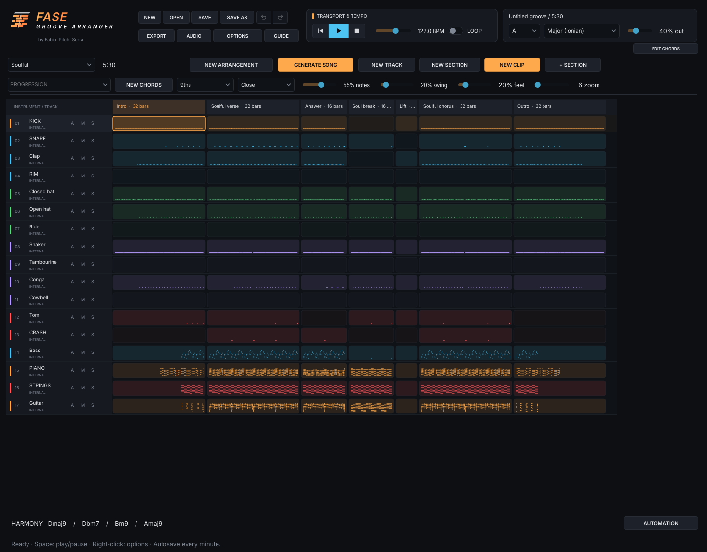
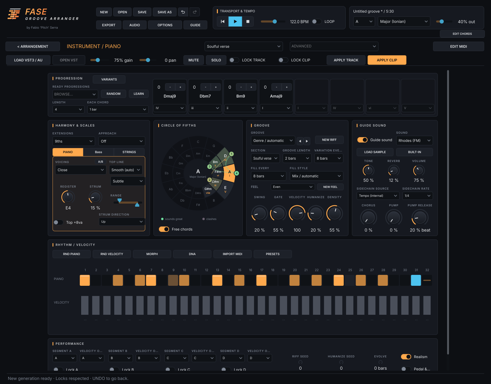
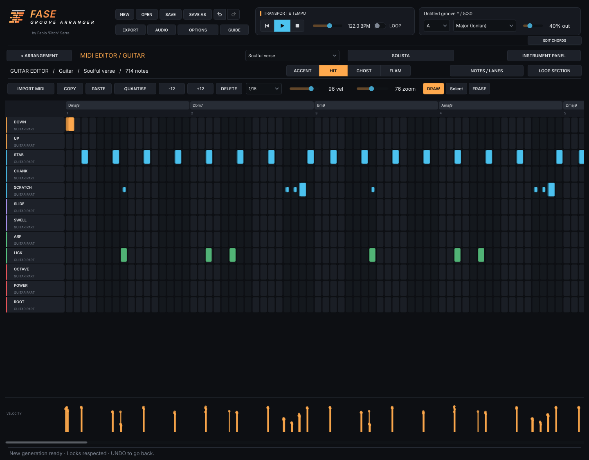
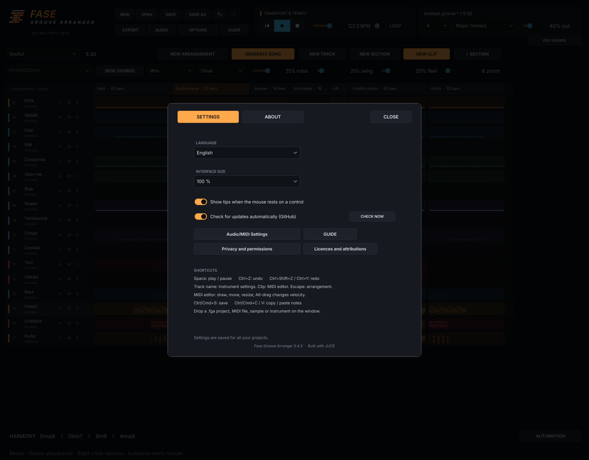

# Guida di utilizzo – Fase Groove Arranger

*🇬🇧 [English version](GUIDE.md)*

Fase Groove Arranger **crea MIDI** di brani per soulful, deep, jackin’ house e gli altri generi
della famiglia: scegli tonalità, accordi e groove, ascolti il brano con i suoni guida e poi
**esporti MIDI o audio nella DAW**, oppure usi direttamente i tuoi campioni e strumenti VST3/AU.

**Indice**

1. [Installazione](#1-installazione)
2. [Primo giro in 60 secondi](#2-primo-giro-in-60-secondi)
3. [L’interfaccia, sezione per sezione](#3-linterfaccia-sezione-per-sezione)
4. [Esportare MIDI e audio nella DAW](#4-esportare-midi-e-audio-nella-daw)
5. [Usare gli strumenti in tempo reale](#5-usare-gli-strumenti-in-tempo-reale)
6. [Costruire un brano: intro, break, drop](#6-costruire-un-brano-intro-break-drop)
7. [Ricette soulful house](#7-ricette-soulful-house)
8. [Domande frequenti e problemi](#8-domande-frequenti-e-problemi)
9. [Ascolta la mia musica](#9-ascolta-la-mia-musica)

---

## 1. Installazione

Questa guida descrive la **v0.4.4** di Fase Groove Arranger. Scarica il pacchetto del tuo sistema
dall’[ultima release](https://github.com/wsx79/fasegroovearranger/releases/latest) ed estrailo.

### Installazione manuale (zip / tar.gz, tutti i sistemi)

Scarica il pacchetto del tuo sistema e scompattalo. L'app funziona da sola: **non devi installare una DAW o i tre plugin Fase Groove**.

| Sistema | Pacchetto | Avvio |
|---|---|---|
| Windows | `.zip` | Apri la cartella estratta e avvia `Fase Groove Arranger.exe`. |
| macOS | `.tar.gz` | Estrai l'archivio e apri `Fase Groove Arranger.app`. Il pacchetto è universale, Intel e Apple Silicon. |
| Linux | `.tar.gz` | Estrai l'archivio e avvia `Fase Groove Arranger`. Conserva i permessi di esecuzione. |

Se scarichi da GitHub Actions, nello ZIP dell'artifact trovi il pacchetto indicato nella tabella: estrai anche quello. Questi pacchetti sono portatili; non hanno installer o firma di distribuzione.

**Al primo avvio:** premi **AUDIO**, scegli l'uscita che usi per ascoltare e un buffer adatto al tuo dispositivo. L'app usa l'uscita audio; non apre il microfono.

> Parti dal suono guida. Puoi ascoltare e costruire tutto il brano prima di scegliere i tuoi strumenti.

---

## 2. Primo giro in 60 secondi

1. Nel menu del genere scegli **Soulful**.
2. Scegli il groove: la durata segue il genere e lo sviluppo delle frasi, senza un numero di minuti imposto.
3. Premi **NUOVO ARRANGIAMENTO**: compaiono intro, parti principali, break e outro.
4. Premi **AVVIA** o la **barra spaziatrice** e ascolta.
5. Clicca un **clip del piano** nella parte principale: si apre il piano roll grande. Sposta una nota o cambia la sua dinamica.
6. Torna con **< ARRANGIAMENTO**. Clicca il **nome Piano** e scegli un suono, un campione o il tuo VST.
7. Premi **SALVA**, dai un nome al progetto e poi **EXPORT** per salvare un WAV, un MP3 o il MIDI.

Vuoi un'altra versione? **NUOVA TRACCIA** cambia solo lo strumento scelto; **NUOVO CLIP** cambia solo quella traccia in quella sezione. **ANNULLA** ti riporta al tentativo precedente.

> Hai trovato una parte che ti piace? Apri il suo pannello e accendi **BLOCCA TRACCIA** o **BLOCCA CLIP** prima di provare altre varianti.

---

## 3. L’interfaccia, sezione per sezione

### Interfaccia attuale

Tutti i pulsanti dell’interfaccia sono disegnati allo stesso modo: **acceso (pieno) = attivo**,
in rilievo = spento. L’**ambra** indica le azioni principali, l’**azzurro** il trasporto e
l’automazione. I colori di piano, basso, archi, chitarra e batteria restano quelli della famiglia.
Ogni pulsante ha il suo tooltip. Clicca il nome di una traccia per i parametri, il clip per le note.

In alto trovi i comandi del progetto, il trasporto e quello che vale per tutti: **tempo, tonalità e scala**. Sotto scegli genere e giro di accordi; la durata mostrata è quella risultante. La parte grande è il brano, con le sezioni in orizzontale e gli strumenti in verticale.

| Dove | Cosa trovi |
|---|---|
| **NUOVO · APRI · SALVA · SALVA COME** | Un progetto nuovo, l'apertura e il salvataggio dei tuoi brani. |
| **AVVIA · FERMA · LOOP** | Ascolto, ritorno all'inizio e ripetizione della zona scelta. Il cursore azzurro mostra dove sei. |
| **Genere e durata** | Il genere determina la forma; la durata è un risultato di groove e frasi armoniche, mostrato senza un cursore dei minuti. |
| **PROGRESSIONE · MODIFICA ACCORDI** | I giri pronti e la modifica dei singoli accordi. La riga HARMONY mostra il giro attuale. |
| **Arrangiamento** | Ogni rettangolo è un clip: le note di uno strumento in una sezione. |
| **Nome della traccia** | Apre il pannello dello strumento, con groove, esecuzione, suono e mixer. |
| **Clip** | Apre l'editor MIDI grande, soltanto per quella traccia e quella sezione. |
| **AUDIO · OPZIONI · GUIDA** | Dispositivo audio; informazioni, crediti e privacy; questa guida. |

I colori seguono gli strumenti: **ambra** per piano e cassa, **azzurro** per basso e rullanti/clap, **verde** per i piatti, **viola** per le percussioni, **rosso** per archi e tom/crash. Nella chitarra ogni gruppo di pennate ha il suo colore.

**M** e **S** accanto al nome di una traccia fanno mute e solo senza aprirla. Il clic sull'intestazione di una sezione porta la riproduzione al suo inizio. Lo **ZOOM** cambia quanto brano vedi.

### Trasporto e tempo (in alto)

| Controllo | Cosa fa |
|---|---|
| **⏮ ▶/❚❚ ■** | Torna all’inizio, play / pausa, stop. La barra spaziatrice fa play / pausa. |
| **TEMPO** | Cambia i BPM dell’intero brano nel range del genere scelto. La durata in minuti segue le battute. |
| **LOOP** | Ripete la zona impostata; LOOP SEZIONE ripete la parte scelta nell’editor. |

### Progression, Harmony & Scales e Groove

**Tonalità e scala sono una sola scelta per tutto il brano.** Piano, basso, archi e chitarra usano lo stesso giro. Non serve collegare i singoli strumenti con LINK.

| Controllo | Cosa fa |
|---|---|
| **Tonalità / Scala** | La fondamentale e il modo del brano. Sono in alto, accanto al tempo. |
| **PROGRESSIONE** | Sceglie un giro dalla libreria di Fase Groove Piano. Alcuni giri impostano anche la scala adatta. |
| **NUOVI ACCORDI** | Prepara un altro giro di gradi nella scala scelta. |
| **MODIFICA ACCORDI** | Cambia ogni accordo: grado della scala oppure maggiore, minore o dominante su una fondamentale cromatica. Da 1 a 8 accordi, con durata condivisa. |
| **Estensioni / Voicing** | Il colore degli accordi e la disposizione delle note del piano. |
| **DENSITÀ** | Da poche note a un groove più fitto. |
| **SWING** | Sposta i sedicesimi alternati: da dritto a più shuffle. |
| **FEEL / UMANIZZA** | Piccole differenze di tempo e dinamica. |

Il **tempo** cambia subito la velocità di ascolto. Le altre scelte preparano la prossima generazione: le note che hai già scritto restano al loro posto finché non le applichi.

Nel pannello di uno strumento, **APPLICA TRACCIA** o **APPLICA CLIP** applica i suoi parametri mantenendo la variante del groove. I pulsanti **NUOVO** nell'arrangiamento scelgono invece un'altra variante.

> Dopo aver cambiato tonalità o giro, rigenera insieme gli strumenti interessati. Una parte bloccata conserva le sue note, anche se il resto del brano cambia armonia.

### Le tracce: piano esteso, basso, archi e batteria

Le prime tredici tracce sono i pezzi della batteria: **Kick, Snare, Clap, Rim, Closed hat, Open hat, Ride, Shaker, Tambourine, Conga, Cowbell, Tom, Crash**. Seguono **Bass, Piano, Strings e Guitar**. La chitarra resta tutta su una traccia.

Clicca il **nome** di uno strumento per aprire il suo pannello. In alto scegli con cosa ascoltarlo; sotto trovi groove, feel, esecuzione e fill. **EDIT MIDI** apre le note; **< ARRANGIAMENTO** torna al brano.

| Strumento | Da dove partire |
|---|---|
| **Piano** | Groove, gate, registro e strum; poi movimento, linea in alto e range per rifinire la mano destra. |
| **Bass** | La linea di basso e il suo feel: classico, sub o sub con spazi sul beat. |
| **Strings** | Lo stile degli archi: un sostegno lungo o una parte più ritmica. |
| **Batteria** | Soltanto il pezzo scelto: groove, dinamica, nota MIDI e posizione rispetto al beat. |
| **Guitar** | Pennate, let ring, spazio per la band, anticipi e mixer delle dodici righe. |

I cursori **VOLUME** delle parti della chitarra regolano il suono guida; **LEVEL** della parte scelta cambia le dinamiche MIDI alla generazione. I mute delle parti agiscono anche sull’ascolto delle note già scritte. L’esportazione MIDI conserva le note del clip.

#### Piano: vista estesa

Le schermate mostrano la lingua inglese; i nomi dei comandi qui sotto seguono la lingua italiana.

Il piano usa i pannelli affiancati della vista estesa: Armonia e scale, Circolo delle quinte, Groove e Suono guida. Sotto trovi Ritmo/Dinamica ed Esecuzione. Tonalità, scala e trasporto restano nella barra della DAW. Il menu **ESTESA** porta direttamente alle sezioni.

Trovi i **rivolti per accordo**, il seed del riff e del feel, **NUOVO FEEL**, pedale ed espressione CC64/CC11, ordine e blocchi A–D, griglia di 32 step e cursori della dinamica. Clicca uno step per scegliere pausa, nota, accento, ghost, anticipo o tenuto. Trascina il cursore per la dinamica; doppio clic torna al valore automatico. **RND PIANO** cambia il ritmo rispettando i segmenti bloccati; **DINAMICHE CASUALI** cambia solo le dinamiche.

**DNA**, **MORPH**, **A/B**, **VARIANTS** e il **CIRCOLO DELLE QUINTE** usano gli strumenti musicali originali. I risultati preparano i parametri: APPLICA TRACCIA / APPLICA CLIP scrive le note. A e B permettono anche l'ascolto del clip con due voicing: ANNULLA annulla la prova. PRESETS salva e carica i parametri della traccia in file `.fgapreset`. IMPORTA MIDI stima accordi e ritmo; verifica il risultato prima di rigenerare. **LEARN** apprende un accordo quando rilasci tutti i tasti, dopo aver scelto l'ingresso MIDI.

Da **MODIFICA ACCORDI → Ogni accordo** imposti la durata armonica condivisa: mezza, una, due o quattro battute. Il pump del suono guida offre frequenza, rilascio e sorgente **Tempo / MIDI della cassa**. Quest'ultima segue le note della traccia Kick; non è un ingresso audio esterno.

Da **OPZIONI → IMPOSTAZIONI → Lingua** scegli italiano, inglese, spagnolo, francese, tedesco o portoghese. I suggerimenti dei controlli si attivano e disattivano nello stesso pannello. Entrambe le preferenze restano sul computer; i manuali completi sono disponibili in italiano e inglese.

#### Suono guida, campione o VST

| Pulsante | Cosa scegli |
|---|---|
| **BUILT-IN** | Torna al suono guida. Piano e basso hanno i sette timbri di tastiera; archi, quattro chitarre e quattro kit hanno i loro suoni. |
| **CARICA CAMPIONE** | Un tuo WAV, AIFF, FLAC o OGG, fino a 60 secondi. Il campione resta sul disco; il progetto ne ricorda il percorso. |
| **CARICA VST3 / AU** | Uno strumento installato sul tuo computer. Scegli il bundle `.vst3`; su macOS puoi scegliere anche un'Audio Unit installata. |
| **APRI VST** | L'interfaccia dello strumento che hai caricato. |

**GAIN, PAN, MUTE e SOLO** appartengono alla traccia. **TIMBRO, RIVERBERO, CHORUS e PUMP** cambiano soltanto il suono guida; per il suono del tuo VST usa i suoi comandi. I parametri di groove continuano a scrivere il MIDI che gli arriva.

Per un campione intonato, la radice iniziale è MIDI 60. Per la batteria è la nota del pezzo. **Tasto destro sul nome → Radice campione** la cambia. È un campione trasposto sulle note della traccia, non una libreria multisample.

### Piano roll e griglia ritmica

Clicca un **clip**: l'editor occupa la finestra. Il menu della sezione sceglie la parte da modificare; **LOOP SEZIONE** la ripete mentre lavori. Ogni editor mostra soltanto la sua traccia. Per i pezzi della batteria c'è una sola riga.

| Azione | Risultato |
|---|---|
| **Clic nel vuoto** | Aggiunge una nota sulla griglia. |
| **Trascina una nota** | La sposta nel tempo; nel piano roll intonato cambia anche l'altezza. |
| **Bordo destro della nota** | Cambia la durata delle note intonate. |
| **Alt + trascina in verticale** | Cambia la dinamica, senza spostare la nota. |
| **Shift + clic** | Aggiunge o toglie una nota dalla selezione. |
| **Tasto destro / ELIMINA / Backspace** | Elimina la nota. Nelle lane della chitarra, il tasto destro elimina il gesto di pennata. |
| **Ctrl/Cmd + A** | Seleziona tutte le note del clip. |
| **QUANTIZZA** | Allinea alla griglia scelta: 1/4, 1/8, 1/16 o 1/32. |
| **−12 / +12** | Sposta le note intonate di un'ottava. |
| **VEL** | Cambia la dinamica della selezione; senza selezione, quella delle note nuove. |
| **COPIA / INCOLLA** | Copia la selezione, oppure tutto il clip, e incolla mantenendo le posizioni nella sezione. |

Quantise e trasposizione lavorano sulla selezione; senza selezione, su tutto il clip. Lo **ZOOM** ingrandisce i dettagli nel tempo. **Esc** torna all'arrangiamento.

**IMPORTA MIDI**, oppure un `.mid` trascinato sulla finestra, sostituisce le note del clip scelto. Il tempo del progetto resta quello dell'Arranger. Nel kick o in un altro pezzo di batteria, le note importate vengono assegnate al solo pezzo scelto. **ANNULLA** recupera il clip precedente.

### Parte di chitarra e mixer

La chitarra si modifica come in Fase Groove Guitar: **dodici modi di suonare lo stesso accordo, tutti nella stessa traccia**.

| Riga | Cosa suona |
|---|---|
| **DOWN / UP** | Pennate giù sull'accordo e pennate su sulle corde acute. |
| **STAB / CHANK** | Accordi corti e chop funk molto brevi. |
| **SCRATCH** | Il colpo stoppato, per riempire gli spazi ritmici. |
| **SLIDE / SWELL** | Slide verso l'accordo e ingressi in crescendo. |
| **ARP / LICK** | Una corda alla volta e frasi sull'accordo. |
| **OCTAVE / POWER / ROOT** | Ottave, power chord e fondamentale sulle corde basse. |

Clicca nella lane per aggiungere una pennata sull'accordo della battuta. Le sue note si selezionano e si spostano insieme. **NOTE / RIGHE** passa al piano roll quando vuoi intervenire su una singola nota.

#### Chi porta avanti il giro?

Nel pannello o nell'editor della chitarra, **SOLISTA** cambia i ruoli. Con **SOLISTA** attivo, la chitarra porta il groove e il piano lascia spazio, con accordi e risposte di accompagnamento. Piano e chitarra vengono aggiornati rispettando i blocchi. **ANNULLA** torna ai ruoli precedenti.

Nel mixer, le dodici righe sono affiancate: **livello, ottava, mute, quota di swing e push/pull**. Il push/pull è in millisecondi: negativo anticipa, positivo ritarda.

> Per lasciare spazio al basso, prova **Room for band**. Per una chitarra più percussiva, accorcia le pennate e riduci **Let ring**. Ascolta la chitarra insieme al piano, non soltanto in solo.

### PROGETTO, annulla e ripeti

**SALVA / SALVA COME** salva un progetto `.fga`: sezioni, note, parametri, blocchi, mixer e stato dei VST. I campioni e i plugin restano nei loro percorsi: conserva i file usati dal brano.

Ogni minuto viene scritta una copia di recupero se ci sono modifiche. **AUDIO → Recupera autosave** la apre; **Apri cartella autosave** mostra dove si trova. Salva copie con nomi diversi quando vuoi conservare versioni del brano. ANNULLA conserva fino a quaranta passaggi mentre l'app è aperta.

### Scorciatoie

| Tasti | Azione |
|---|---|
| **Spazio** | Play / pausa. |
| **Esc** | Torna all'arrangiamento dall'editor. |
| **Ctrl/Cmd + S** | Salva. |
| **Ctrl/Cmd + Shift + S** | Salva con un altro nome. |
| **Ctrl/Cmd + Z** | Annulla. |
| **Ctrl/Cmd + Shift + Z / Ctrl/Cmd + Y** | Ripeti. |
| **Ctrl/Cmd + A**, nell'editor | Seleziona le note del clip. |
| **Delete / Backspace**, nell'editor | Elimina la selezione. |

Nella guida, **Ctrl/Cmd + F** porta alla ricerca. Le frecce accanto alla ricerca passano tra i risultati; **A− / A+** cambia la dimensione del testo. Clicca una schermata per aprirla più grande.

### OPZIONI: impostazioni, lingua e crediti

**OPZIONI → IMPOSTAZIONI** segue lo stesso pannello di Piano, Drums e Guitar: lingua, dimensione interfaccia, tooltip e aggiornamenti. **INFO** contiene i crediti e i pulsanti SOURCE CODE, Ko-fi, PayPal e Spotify. Audio, guida, privacy e licenze si aprono dai pulsanti aggiunti sotto le preferenze. La guida sorgente è questo documento Markdown, come nelle altre app.

> In questa guida i comandi sono indicati col nome inglese o italiano; con l’interfaccia
> nell’altra lingua trovi l’etichetta tradotta nello stesso punto. Nomi degli accordi, modi e
> groove restano invariati.

---

## 4. Esportare MIDI e audio nella DAW

| In EXPORT | Cosa ottieni |
|---|---|
| **MIDI** | Il brano multitraccia, una traccia o tutte le tracce in file separati. Comprende tempo e marker delle sezioni; non contiene i suoni. |
| **WAV** | Mix, singola traccia o tutti gli stem, stereo a 24 bit. È il formato da usare per continuare il mixaggio. |
| **MP3** | Mix, singola traccia o tutti gli stem, stereo a 320 kbps / 44,1 kHz. L'encoder è incluso. |

Gli stem WAV partono tutti dall'inizio del brano, hanno la stessa durata e comprendono tre secondi di coda. Anche una traccia vuota produce un file allineato. Il mix segue mute e solo; uno stem viene esportato anche se la sua traccia è muta e conserva gain, pan e livello master.

> Per riportare gli stem in una DAW scegli WAV. L'MP3 aggiunge il ritardo del codec: va bene per ascoltare e condividere, non per l'allineamento preciso delle tracce.

---

## 5. Usare gli strumenti in tempo reale

Arranger ospita direttamente gli strumenti: apri il **nome della traccia**, scegli
**BUILT-IN**, **CARICA CAMPIONE** oppure **CARICA VST3 / AU**, quindi premi **APRI VST** per
i controlli del tuo strumento. Premi **▶** per ascoltare le note del progetto.

Il tempo e la posizione sono quelli del brano; non servono LINK o SYNC DAW tra i motori interni.
Per continuare in un’altra DAW usa il MIDI o gli stem del capitolo 4.

---

## 6. Costruire un brano: intro, break, drop

**NUOVO ARRANGIAMENTO** prepara la forma del genere scelto e scrive il MIDI. La durata deriva dalle sezioni del genere, dai cicli armonici completi e dallo sviluppo del groove. Un motivo più lungo o in evoluzione ha spazio per completarsi; un groove denso può rispondere prima. Non esiste un obiettivo fisso in minuti.

| Parte | Come usarla |
|---|---|
| **Intro** | L’ingresso appartiene alla struttura del genere. Frasi complete, entrate e sviluppo degli strumenti tengono conto delle transizioni tra brani; le prime frasi lasciano spazio al mixaggio, poi entrano progressivamente accordi, basso e altri strumenti. |
| **Main** | Il groove principale. Qui fai riconoscere il giro e il suono del brano. |
| **Breakdown** | Un respiro: cambiano gli spazi e il ruolo degli strumenti. |
| **Build-up** | Una salita verso la ripartenza, nei generi che la prevedono. |
| **Drop** | Il ritorno del groove pieno. Non deve per forza suonare identico alla prima parte. |
| **Outro** | Gli strumenti escono progressivamente dentro la sezione; l’ultima frase ritmica permette il passaggio al brano successivo. Nessuna parte per il mixaggio viene aggiunta fuori dalla canzone. |

La forma segue il genere. **Deep e Chill** si sviluppano con parti più distese; **Jackin'** ha break brevi e ripartenze; **Garage & UK** alterna due drop e un taglio; **Soulful e Gospel** lavorano su risposte e riprese; **Afro & Latin** dà spazio alle percussioni; **Funky & Disco** alterna strofe e ritornelli.

I BPM sono scelti nel range del genere: Soulful 118–125, Deep 115–125, Garage & UK 130–135, Afro & Latin 115–125. Il controllo tempo usa il range dello stile scelto. Le categorie Neo Soul / Broken e Chill / Pads mantengono un carattere da warm-up a BPM più bassi. La durata in secondi è `battute × 240 / BPM`.

Il groove di base resta riconoscibile fra le sezioni: cambiano interpretazione, densità e ruoli. Le sezioni automatiche seguono frasi da otto battute anche con progressioni di tre, cinque o sette accordi; il ciclo armonico continua attraverso i confini invece di ripartire sempre dal primo accordo.

### Cambiare solo quello che serve

| Pulsante | Cosa cambia |
|---|---|
| **GENERA BRANO** | Nuove varianti su tutte le tracce sbloccate, conservando le sezioni attuali. |
| **NUOVA TRACCIA** | La traccia selezionata, lungo tutto il brano. |
| **NUOVA SEZIONE** | La sezione selezionata, su tutte le tracce sbloccate. |
| **NUOVO CLIP** | Soltanto la traccia selezionata in quella sezione. |
| **NUOVO ARRANGIAMENTO** | Ricostruisce forma e note in base a genere, frasi armoniche e sviluppo del groove. Prima devi sbloccare tracce e clip. |

**Tasto destro sulla sezione:** rinomina, duplica con le note, sposta, elimina, cambia durata o funzione musicale. **+ SECTION** aggiunge una parte Main dopo quella scelta. Allungare una sezione lascia spazio vuoto: rigenera o scrivi le note per riempirlo. Accorciarla taglia le note oltre il nuovo confine.

> Prova così: duplica il drop, cambia soltanto il basso della seconda copia, poi alleggerisci il piano. Mantieni un'idea riconoscibile e cambia chi la porta avanti.

### Automazione del volume traccia

Nella vista arrangiamento, **A** nell’intestazione di ogni traccia apre la corsia volume. **AUTOMAZIONE** apre o nasconde quella della traccia selezionata. Le corsie partono nascoste e l’automazione è disattivata: il volume normale resta al fader dello strumento.

- Clic nella corsia: aggiunge un punto e attiva l’automazione; il primo clic crea anche gli estremi a volume neutro.
- Trascina un punto: cambia posizione e livello. La griglia è di un beat; **Maiusc** consente tempi liberi. Aumenta lo zoom per lavorare con precisione.
- **Alt + trascina sul segmento fra due punti**: curva la salita o la discesa; al centro resta lineare.
- Clic destro: elimina il punto, azzera la sua curva, cancella l’inviluppo oppure attiva/disattiva l’automazione.
- **ON / BYPASS** a sinistra della corsia: attiva o esclude la linea mantenendo i punti. Nasconderla con **A** non ne modifica l’ascolto. ANNULLA/RIPETI comprende le modifiche ai punti.

Il valore è un moltiplicatore del fader: 0% = silenzio, 100% = volume invariato, 200% = circa +6 dB. Fra i punti il valore cambia continuamente, anche sulle note tenute e sulle code degli effetti. Prima del primo punto e dopo l’ultimo mantiene il valore estremo. Funziona sui suoni interni, sui campioni e sui VST/AU, in riproduzione e nei WAV/MP3 di mix e singole tracce.

L’inviluppo si salva nel `.fga`, è indipendente dai BPM e dalla rigenerazione MIDI; inserendo, duplicando, eliminando o spostando sezioni anche i punti si spostano con esse. Cambiare la durata di una sezione o creare una nuova forma con NUOVO ARRANGIAMENTO mantiene invece i tempi assoluti dei punti e li limita alla nuova durata: ricontrolla la linea. I vecchi progetti si aprono con automazione spenta. La visibilità è una preferenza della sessione di lavoro e non è salvata nel progetto.

L’automazione volume **non modifica le velocity e non viene convertita in CC MIDI**: resta un controllo audio della DAW. Le dinamiche espressive dei motori originali continuano a funzionare; le rampe extra di velocity aggiunte dall’arranger per simulare un fade sono rimosse. Per portare le curve fuori dall’app esporta l’audio; il MIDI contiene le note e i CC musicali originali.

---

## 7. Ricette soulful house

| Sound | Impostazioni |
|---|---|
| **Classico deep house anni '90** | A Dorian · *Dorian Vamp i – IV* · 9ths · Close · *Classic Offbeat Stabs* · Swing 20% · Gate 40% |
| **Kerri Chandler style** | F Minor (Aeolian) · *Late Night i – VII – VI – VII* · 11ths · Wide · *Deep Chords* · Swing 30% |
| **Gospel / soulful** | Eb Major · *Gospel Lift IV – V – vi – I* · 9ths · Drop 2 · *Gospel Bounce* · Fills ogni 4 battute |
| **Funky disco house** | C Mixolydian · *Mixo Groove* · 7ths · Close · *Nile Chops* o *Funk Clav Chops* · Bass: Octaves |
| **Jazzy late night** | D Major · *Circle of 5ths vi – ii – V – I* · 11ths · Rootless · *Neo Soul Lazy* · Humanize 40% |
| **Moderno / quartale** | G Dorian · *Deep Minor i – v* · 9ths · Quartal · *Broken Beat* · Swing 15% |
| **Soulful grand** | Eb Major · *Soulful Gospel I – iii – IV – V* · 9ths · Drop 2 · Sound: *Soulful Grand* · *Soulful Sunday* · Strum 25% · Reverb 40% |
| **Piano house anni '90** | C Minor (Aeolian) · *Jackin' Minor i – iv* · 7ths · Close · Top +8va · Sound: *House Piano (M1 style)* · *Classic Offbeat Stabs* |
| **Organo jackin'** | G Dorian · *Deep Dorian i – ii – IV – i* · 7ths · Close · Sound: *House Organ* · *Jack Organ Pump* · Swing 40% |
| **Jackin' house** | A Minor (Aeolian) · *Jackin' Minor i – iv* · 7ths · Close · *Jackin' Stabs* o *Jack Bounce* · Swing 40% · Gate 35% · Bass: Octaves |
| **Slide gospel** | Eb Major · *Turnaround I – vi – ii – V* · 9ths + altered V · Drop 2 · Approach chord: From above · *Gospel Bounce* · Strum 20% |
| **Deep sospeso** | F Dorian · *Dorian Vamp i – IV* · Sus (9sus4) · Wide · *Deep Chords* · Reverb 40% |
| **Funk lidio dominante** | E Lydian Dominant · *Lydian Dom Funk I7#11 – II* · 9ths · Shell · *Funky Upstrokes* · Swing 30% |
| **Afro-deep scuro** | A Phrygian Dominant · *Dark Deep I – II* · 7ths · Drop 2+4 · *Deep Sway* · Gate 70% |
| **Ispirazione casuale** | 🎲 CASUALE + 🎲 NUOVO RIFF più volte, Density 30–60%, poi esporta quello che ti piace |

Applica queste impostazioni nei pannelli della traccia e usa **APPLICA TRACCIA / APPLICA CLIP**.
Poi costruisci il brano con gli esempi qui sotto.

### Soulful: piano davanti, chitarra negli spazi

1. Scegli **Soulful** e il groove, poi premi **NUOVO ARRANGIAMENTO**.
2. Nel piano parti da **Rhodes (FM)** e un giro con settime o none.
3. Ascolta la parte principale. Se è troppo piena, abbassa la densità del piano e premi **APPLICA CLIP**.
4. Lascia la chitarra in accompagnamento. Usa il suo mixer per togliere le righe che coprono il piano.
5. Blocca la parte di piano che ti piace e prova un **NUOVA TRACCIA** sul basso.

### Deep: meno note, più spazio

1. Scegli **Deep** e genera la forma del brano.
2. Nel piano prova un registro più raccolto, gate più lungo e poche note.
3. Per il basso scegli un feel **Sub**. Lascia gli archi come sostegno e ascolta il break.
4. Duplica una parte principale e cambia soltanto una o due tracce nella ripresa.

### Jackin': groove corto e ripartenze

1. Scegli **Jackin'** o **Jackin' Piano**.
2. Parti da gate corto sul piano e un feel più swingato.
3. Nel break togli quello che serve alla ripartenza: un **NUOVO CLIP** sul piano può bastare.
4. Tieni la cassa riconoscibile e confronta la ripartenza con il tratto precedente usando **LOOP SEZIONE**.

### Funky & Disco: la chitarra guida

1. Scegli **Funky & Disco** e genera il brano.
2. Apri la chitarra e attiva **SOLISTA**.
3. Ascolta DOWN, UP, CHANK e OCTAVE nel contesto; riduci quelle che si sovrappongono troppo.
4. Prova gli archi nel ritornello e lascia più vuoto il giro precedente.
5. Controlla intro e outro: la prima e l’ultima frase ritmica lasciano spazio al mixaggio; gli strumenti entrano ed escono dentro la struttura del brano.

---

## 8. Domande frequenti e problemi

**Ho cambiato tonalità, ma sento ancora gli accordi di prima**

Hai preparato una nuova tonalità, mentre i clip contengono ancora le note precedenti. Rigenera gli strumenti armonici interessati. Controlla i blocchi: una parte bloccata mantiene le proprie note.

**Non sento niente**

Controlla **AUDIO**, l'uscita scelta, AVVIA, il livello master e MUTE/SOLO. Nel pannello della traccia premi **BUILT-IN** per ascoltare con il suono guida. Se quello funziona, controlla il campione o il VST assegnato.

**Il VST o il campione non si trova più**

Il progetto ne ricorda il percorso, ma il file può essere stato spostato o mancare su questo computer. Usa **CARICA CAMPIONE** o **CARICA VST3 / AU** per ricollegarlo. Controlla anche che il plugin abbia la stessa architettura dell'app e la sua autorizzazione d'uso. Finché uno strumento manca, l'esportazione audio ti chiede di ricollegarlo.

**Ho modificato delle note. Come le tengo mentre provo altro?**

Accendi **BLOCCA CLIP** per quella parte o **BLOCCA TRACCIA** per tutto lo strumento. Poi usa i pulsanti NUOVO sugli altri elementi. Puoi continuare a modificare a mano anche una parte bloccata.

**Da cosa dipende la durata?**

La forma dipende dal genere; il groove e il ciclo armonico stabiliscono lo sviluppo in frasi complete. La durata mostrata segue il brano generato. Cambiare BPM modifica la durata in minuti, senza forzare un nuovo numero di battute.

**Dove sono registrazione, automazioni e catene di effetti?**

Questa versione lavora sull'arrangiamento MIDI. Registrazione audio/MIDI, automazioni diverse dal volume traccia, editing audio, bus/send, catene di effetti esterni e compensazione della latenza dei plugin non sono presenti. Puoi esportare MIDI e WAV per continuare il lavoro nella tua DAW. Alcuni controlli avanzati dei plugin Fase Groove non sono ancora riportati nell'Arranger.

**Il file MIDI non viene importato**

Usa un file MIDI con tempi in PPQ. I file SMPTE non sono supportati. L'importazione entra nel clip scelto e si ferma alla durata della sua sezione; non ricostruisce automaticamente una canzone esterna completa.

**Cosa c’è di nuovo nell’ultima versione?**
Trovi tutte le novità, versione per versione, nel [changelog](../CHANGELOG.it.md) e nella pagina
[Releases](https://github.com/wsx79/fasegroovearranger/releases).

**L’app si collega a internet o raccoglie dati?**
La musica resta sul computer. Solo il controllo aggiornamenti opzionale contatta GitHub;
i link esterni si aprono se li scegli. Vedi la [privacy policy](../PRIVACY.it.md).

---

## 9. Ascolta la mia musica

Fase Groove Arranger è creato da **Fabio 'Pitch' Serra**, DJ e producer. Se ti piace il sound di
questa app, ti piaceranno anche le mie produzioni:

- 🎧 **Ascolta le mie produzioni su Spotify:** [Fabio 'Pitch' Serra su Spotify](https://open.spotify.com/artist/29iQGuXML8LEw3xRp1dNRP)
- 🛒 **Scarica le mie canzoni** sui maggiori distributori digitali di musica: cerca
  **Fabio 'Pitch' Serra**.

Grazie per l'ascolto e per supportare la musica indipendente! 🎹🔥

### Crediti, supporto e privacy

**Fase Groove Arranger è di Fabio 'Pitch' Serra / FS Pitch, DJ & Producer.**

[Ascolta Fabio 'Pitch' Serra su Spotify](https://open.spotify.com/artist/29iQGuXML8LEw3xRp1dNRP)

[Offrimi un caffè su Ko-fi](https://ko-fi.com/fabios1979)

[Supporta il progetto con PayPal](https://paypal.me/fabios79)

Assistenza allo sviluppo: **Claude (Anthropic)** e **Codex (OpenAI)**, AI coding assistants. Crediti, licenze e privacy si aprono da **OPZIONI**.

[Codice sorgente e famiglia Fase Groove](https://github.com/wsx79/fasegroovearranger)

L'app è gratuita e open source, **GNU AGPL v3 o successiva**. Usa JUCE e il carattere Inter. Funziona offline, senza account, analytics o caricamenti della tua musica. I collegamenti esterni aprono il browser soltanto se li scegli. Campioni e VST personali mantengono le proprie licenze e condizioni; i dettagli sono in Privacy e Licenze, incluse nel pacchetto.
