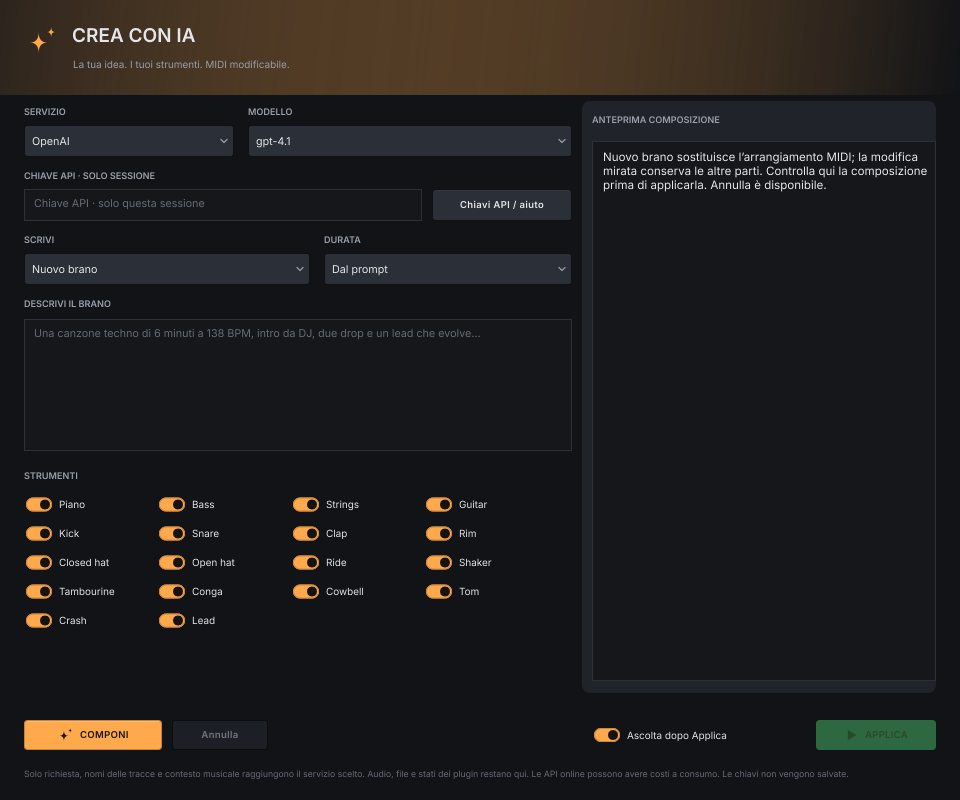

# Guida di utilizzo – Fase Groove Arranger

*🇬🇧 [English version](GUIDE.md)*

Fase Groove Arranger **crea MIDI** di brani per soulful, deep, jackin’ house e gli altri generi
della famiglia: scegli tonalità, accordi e groove, ascolti il brano con i suoni guida e poi
**esporti MIDI o audio nella DAW**, oppure usi direttamente i tuoi campioni e strumenti VST3/AU.

**Indice**

1. [Installazione](#1-installazione)
2. [Primo giro in 60 secondi](#2-primo-giro-in-60-secondi)
3. [L’interfaccia, sezione per sezione](#3-linterfaccia-sezione-per-sezione)
4. [Esportare MIDI e audio nella DAW](#4-esportare-midi-e-audio-nella-daw)
5. [Usare gli strumenti in tempo reale](#5-usare-gli-strumenti-in-tempo-reale)
6. [Costruire un brano: intro, break, drop](#6-costruire-un-brano-intro-break-drop)
7. [Ricette soulful house](#7-ricette-soulful-house)
8. [Domande frequenti e problemi](#8-domande-frequenti-e-problemi)
9. [Ascolta la mia musica](#9-ascolta-la-mia-musica)

**Accesso rapido:**

- [Campionatore e Studio](#studio-campionatore-registrazione-e-campioni)
- [Mixer e mandate](#mixer-gruppi-e-mandate)
- [Automazioni](#pan-master-e-parametri-vst)
- [Battute e tempo trascorso](#battute-e-tempo-trascorso)
- [Esportazione](#4-esportare-midi-e-audio-nella-daw)

La guida è aggiornata alla **0.23.4**. Le schermate mostrano l’interfaccia attuale; alcune usano i nomi inglesi. L’icona **?** nell’app apre questa stessa guida, con ricerca, indice e immagini ingrandibili.

---

## 1. Installazione

Questa guida descrive la **v0.23.4** di Fase Groove Arranger. Scarica il pacchetto del tuo sistema dall’[ultima release](https://github.com/wsx79/fasegroovearranger/releases/latest).

### Installer Windows (consigliato)

Apri **FaseGrooveArranger-Windows-Setup.exe**, scegli italiano o inglese e segui lo stesso wizard delle altre app Fase Groove. Installa l’app standalone, le guide, privacy/licenze e i collegamenti nel menu Start; il collegamento sul desktop è facoltativo. Arranger contiene già i quattro motori Piano, Drums, Guitar e Lead: non servono i plugin Fase Groove o un’altra DAW. Solo il setup richiede i permessi di amministratore. Disinstalla dalle impostazioni di Windows: progetti, esportazioni e preferenze locali restano.

### Installazione manuale (tutti i sistemi)

| Sistema | Pacchetto famiglia | Avvio |
|---|---|---|
| Windows 10/11 x64 | `FaseGrooveArranger-Windows.zip` | Estrai e avvia `Standalone/Fase Groove Arranger.exe`. |
| macOS 11+, Intel + Apple Silicon | `FaseGrooveArranger-macOS.zip` | Estrai, copia l’app da Standalone in Applicazioni e aprila. |
| Linux | `FaseGrooveArranger-Linux.zip` | Estrai e avvia `Standalone/Fase Groove Arranger`. Conserva i permessi di esecuzione. |

Le build seguono la famiglia: uno ZIP per piattaforma e il setup Windows, senza archivi con versione duplicati. Sono incluse guide, licenze e informazioni sui sorgenti; le prove di validazione restano in un artifact Actions separato. Da Actions estrai prima lo ZIP dell’artifact e poi il pacchetto contenuto. Il setup Windows non è firmato. macOS usa la procedura della famiglia: firma ad hoc iniziale, Developer ID/notarizzazione se configurati. Possono comparire gli avvisi di sicurezza del sistema, come nelle altre app.

### Aggiornamenti, come nella famiglia Fase Groove

**OPZIONI → IMPOSTAZIONI → VERIFICA ORA** cerca e scarica il pacchetto corretto. La verifica con download automatico è attiva inizialmente; puoi disattivarla qui per lavorare offline. La schermata della famiglia mostra versione scaricata e novità, con **INSTALLA ORA / PIÙ TARDI / IGNORA QUESTA VERSIONE**.

Salva il progetto prima di **INSTALLA ORA**. Le copie Windows installate eseguono di nuovo il setup in modo silenzioso e si riaprono, mantenendo cartella e preferenze. Le copie portatili scrivibili sostituiscono questa app sul posto e si riaprono; se la sostituzione fallisce vengono ripristinati i file precedenti. In una cartella protetta viene mostrato il download da installare manualmente. Prima dell’installazione viene verificato lo SHA-256 dell’allegato GitHub. Non viene installato nulla senza premere INSTALLA ORA; per i progetti non salvati resta la normale conferma di chiusura.

Download e preparazione rimangono in `Downloads/Fase Groove Arranger updates`, oppure in Documents se Downloads non esiste. Progetti, campioni, esportazioni e autosave non vengono sostituiti. **0.7.0 e precedenti:** installa questa release una volta manualmente; il vecchio pulsante DOWNLOAD apre la pagina release. Dalle versioni successive funziona l’aggiornamento integrato. Su Linux verifica e download usano `curl` di sistema.

**Al primo avvio:** clicca l’**icona altoparlante** in alto a destra, poi **Dispositivo audio / buffer**. Scegli uscita e buffer per ascoltare. L’ingresso audio si abilita da queste impostazioni oppure quando scegli di registrarlo in Studio; non viene aperto automaticamente all’avvio. Su macOS autorizza il microfono se vuoi registrare un ingresso.

> Parti dal suono guida. Puoi ascoltare e costruire tutto il brano prima di scegliere i tuoi strumenti.

---

## 2. Primo giro in 60 secondi

1. Nel menu del genere scegli **Soulful**.
2. Scegli il groove: la durata segue il genere e lo sviluppo delle frasi, senza un numero di minuti imposto.
3. Premi **NUOVO ARRANGIAMENTO**: compaiono intro, parti principali, break e outro.
4. Premi **AVVIA** o la **barra spaziatrice** e ascolta.
5. Fai doppio clic su un **clip del piano** nella parte principale: si apre il piano roll grande. Sposta una nota o cambia la sua dinamica.
6. Torna con **< ARRANGIAMENTO**. Seleziona **Piano** e, nell’inspector, scegli **BUILT-IN**, **CAMPIONE** o **VST / AU**. L’ingranaggio della traccia apre invece il pannello musicale originale.
7. Premi **SALVA**, dai un nome al progetto e poi **EXPORT** per salvare un WAV, un MP3 o il MIDI.

Vuoi un'altra versione? **RIGENERA TRACCIA** cambia solo lo strumento scelto; **RIGENERA CLIP** cambia solo quella traccia in quella sezione. **ANNULLA** ti riporta al tentativo precedente.

> Hai trovato una parte che ti piace? Apri il suo pannello e accendi **BLOCCA TRACCIA** o **BLOCCA CLIP** prima di provare altre varianti.

---

Le nuove rigenerazioni del piano confrontano gli attacchi della figura precedente con quelli estratti dal generatore del genere: una diversa velocity o umanizzazione da sola non conta come un nuovo ritmo. APPLY e il caricamento di un progetto mantengono la figura salvata; i segmenti bloccati restano protetti.

## 3. L’interfaccia, sezione per sezione

### Interfaccia attuale

Tutti i pulsanti dell’interfaccia sono disegnati allo stesso modo: **acceso (pieno) = attivo**,
attenuato = spento. L’**ambra** indica le azioni principali, l’**azzurro** il trasporto e
l’automazione. I colori di piano, basso, archi, chitarra e batteria restano quelli della famiglia.
Ogni pulsante ha il suo tooltip. Clicca il nome per selezionare la traccia; l’ingranaggio ambra accanto a Solo apre i parametri. Doppio clic sul clip per le note.

In alto trovi i comandi del progetto, il trasporto e quello che vale per tutti: **tempo, tonalità e scala**. Sotto scegli genere e giro di accordi; la durata mostrata è quella risultante. La parte grande è il brano, con le sezioni in orizzontale e gli strumenti in verticale.

| Dove | Cosa trovi |
|---|---|
| **NUOVO · APRI · SALVA · SALVA COME** | Un progetto nuovo, l'apertura e il salvataggio dei tuoi brani. |
| **AVVIA · FERMA · LOOP** | Ascolto, ritorno all'inizio e ripetizione della zona scelta. Il cursore azzurro mostra dove sei. |
| **Genere e durata** | Il genere determina la forma; la durata è un risultato di groove e frasi armoniche, mostrato senza un cursore dei minuti. |
| **PROGRESSIONE · MODIFICA ACCORDI** | I giri pronti e la modifica dei singoli accordi. La riga HARMONY mostra il giro attuale. |
| **Arrangiamento** | Ogni rettangolo è un clip: le note di uno strumento in una sezione. |
| **Nome della traccia** | Seleziona la traccia; la rotella apre il pannello in una finestra separata, con groove, esecuzione, suono e mixer. |
| **Doppio clic sul clip / E** | Apre l'editor MIDI grande, soltanto per quella traccia e quella sezione. |
| **Altoparlante · ingranaggio · ?** | Audio e autosave; opzioni, lingua e crediti; guida. Le icone sono in alto a destra. |

I colori seguono gli strumenti: **ambra** per piano e cassa, **azzurro** per basso e rullanti/clap, **verde** per i piatti, **viola** per le percussioni, **rosso** per archi e tom/crash. Nella chitarra ogni gruppo di pennate ha il suo colore.

Trascina il **bordo inferiore del nome di una traccia** per cambiarne l’altezza in modo indipendente (40–240 pixel). Le altre tracce conservano la propria altezza; le durate MIDI restano invariate. Il doppio clic sul bordo ripristina l’altezza iniziale; **Esc** annulla il trascinamento. Le altezze vengono ricordate tra le sessioni.

**M** e **S** accanto al nome di una traccia fanno mute e solo senza aprirla. Il clic sui nomi delle sezioni avvia la riproduzione dal punto indicato. Lo **ZOOM** cambia quanto brano vedi.

Nell’arrangiamento, **doppio clic sul nome di una traccia** (per esempio Kick) seleziona la traccia e apre l’inspector. Il cursore e la riproduzione non si spostano. La **X** compatta nell’angolo dell’inspector lo chiude; **I** o l’icona nella barra superiore lo riaprono. Per rinominare usa invece il nome dentro l’inspector o nel mixer, oppure il menu destro.

Il **volume master**, la **densità delle note**, **Swing** e **Feel** nella schermata principale sono potenziometri: trascina in verticale/orizzontale o modifica il valore numerico. Nell’inspector anche **Volume** e **Pan** hanno potenziometri, con valori sotto; il doppio clic riporta il volume a 0 dB o il pan al centro. Le unità e l’effetto musicale dei controlli restano quelli descritti nelle sezioni seguenti.

### Spazio di lavoro DAW

**ELIMINA TRACCIA MIDI** nell’inspector, o **tasto destro → Elimina traccia MIDI**, rimuove soltanto una traccia aggiunta con + MIDI. **ANNULLA** la ripristina con note, nome, suono ed effetto; le tracce successive mantengono i propri dati. Le tracce degli strumenti generativi non si eliminano.

**+ SEZIONE** apre un piccolo menu: scegli Main, Intro, Breakdown, Build-up, Drop oppure Outro. La sezione scelta viene inserita dopo quella selezionata; ANNULLA ripristina la forma precedente.

Dopo una rigenerazione lo zoom si adatta automaticamente: il brano intero nell’arrangiamento, la durata del clip e l’intervallo delle note nell’editor MIDI.

**+ MIDI**, nell’angolo sopra le intestazioni delle tracce, aggiunge una traccia vuota e apre il piano roll. Scrivi le note a mano, assegna un suono guida, un campione o un VST/AU dall’inspector e usa clip, loop, effetti, automazioni ed export come sulle altre tracce. Sono disponibili fino a **32 tracce totali**. GENERA BRANO, i cambi di genere e gli accordi non riscrivono queste note. Doppio clic sul **nome nell’inspector o nel mixer** per rinominare qualsiasi traccia; resta disponibile anche il menu destro → Rinomina. **APRI VST** apre lo strumento o effetto esterno assegnato.

L’**INSPECTOR** laterale segue la traccia e il clip selezionati: volume in dB, pan, mute/solo, blocchi di generazione, campione o VST e accesso ai pannelli originali. La piccola **icona del pannello** nell’angolo superiore destro lo nasconde e restituisce tutta la larghezza all’arrangiamento. Per riaprirlo usa l’**icona inspector nella barra superiore** oppure **I**. L’icona nella barra superiore resta sempre disponibile. Trascina il **bordo destro** del pannello per regolarne la larghezza; il doppio clic sul bordo ripristina quella predefinita. La dimensione scelta viene ricordata. Se lo spazio verticale è ridotto, scorri il pannello.

Sulla riga **ARMONIA**, a destra sopra **BUS E MANDATE**, trovi **zoom − / cursore / zoom +** e **ADATTA BRANO**. Quest’ultimo inquadra tutta la durata del brano nella larghezza disponibile, anche quando il browser è aperto. Zoom e adattamento non modificano MIDI, snap o Annulla. Le altezze delle tracce restano come le hai impostate.

Il **MIXER** mostra le tracce nell’ordine musicale e un master fisso a destra. I nomi (Kick, Snare, ecc.) sono in alto; la scelta suono guida/sample/VST è in basso. Ogni fader cambia soltanto l’audio; le velocity MIDI restano invariate. I meter si spengono in pausa. L’indicatore **CLIP** del master segnala il superamento del livello massimo: cliccalo per azzerarlo. **ABBASSA MIXER**, in alto a destra nel mixer, richiude i fader e recupera spazio per le tracce; resta una barra con **RIAPRI MIXER**, che ripristina l’altezza precedente. Funzionano anche **MIXER / F3**. Trascina l’intestazione del mixer per regolarne l’altezza; il doppio clic ripristina quella predefinita. La dimensione scelta viene ricordata; i canali scorrono orizzontalmente quando lo spazio non basta.

Quando il mixer è chiuso, la scritta MIXER/livelli viene sostituita da un **meter stereo del master**, con livello in dB e memoria dei picchi. Segue il segnale audio effettivo; riaprendo il mixer scompare e tornano le strip con il proprio master.

Le **linee verticali colorate all’inizio delle sezioni** riprendono il colore della relativa intestazione. Indicano soltanto il punto d’ingresso di Intro, Main, Answer e delle altre parti, senza riempire tutta la sezione.

- **Clic nel clip o nella griglia**: seleziona senza spostare il cursore o interrompere l’ascolto. **Clic in alto sui nomi delle sezioni**: posiziona il cursore e avvia subito la riproduzione da quel punto. Il righello numerato resta disponibile per posizionare il cursore e gestire il loop. **Doppio clic** o **E** apre l’editor MIDI.
- **Bordo destro del clip**: trascina per accorciare o estendere soltanto quel loop, a passi di un beat; **Maiusc** permette passi di un quarto di beat. Il MIDI si ripete senza cambiare velocità o dinamiche. Accorciare non cancella la sorgente: riallungando la recuperi. Puoi superare il confine della sezione; il clip esteso ha precedenza sulle parti coperte della stessa traccia, senza raddoppiare le note.
- **Bordo destro dell’intestazione di sezione**: ridimensiona la guida a passi di una battuta. Si spostano Intro, Main, Break e le etichette successive; clip, locatori e automazione volume restano nelle loro posizioni musicali. Il tasto destro permette di rinominare, cambiare funzione, inserire, duplicare, riordinare o eliminare una sezione della guida. **Esc** annulla; **UNDO** ripristina.
- **Trascina un clip** per spostarlo lungo la timeline o su un’altra traccia; **Alt-trascina** lo copia. Lo spostamento lascia uno spazio vuoto nella posizione originale. Le sovrapposizioni a destinazione vengono sostituite conservando i frammenti esterni. La traccia di destinazione mantiene il proprio suono; il MIDI della batteria viene adattato alla sua corsia. **Maiusc-clic** seleziona altri clip sulla stessa traccia; **Ctrl/Cmd+A** li seleziona tutti.
- **Taglia, copia, incolla, dividi, duplica ed elimina** sono nel menu del tasto destro sul clip e sulla tastiera. Incolla usa il cursore: clicca sul righello numerato, anche dopo la fine attuale, per scegliere la posizione. Dividi taglia il clip selezionato al cursore; Duplica mette le copie dopo l’intervallo selezionato. Elimina lascia uno spazio vuoto. Scorciatoie: **Ctrl/Cmd+X / C / V**, **S o Ctrl/Cmd+E**, **Ctrl/Cmd+D**, **Canc / Backspace**.
- **GRIGLIA** permette battute, beat, mezzi/quarti di beat o tempi liberi. Tieni **Maiusc durante il trascinamento** per spostare liberamente. Tasto destro nello spazio vuoto per **Crea clip MIDI vuoto**. Doppio clic sul clip per modificare le note nell’editor completo dello strumento originale.
- **Clic sul righello delle battute**: sposta il cursore nel punto esatto, come sul righello dell’editor MIDI; **Maiusc-trascina**: imposta l’intervallo di loop. Le due estremità restano visibili anche quando LOOP è spento.
- La barra sopra la timeline contiene **GRIGLIA**, **ZOOM SELEZIONE**, **LOOP SELEZIONE**, **ADATTA BRANO / F** (tutta la forma), **SEGUI** (scorrimento durante la riproduzione) e **AUTOMAZIONE**; a destra **GUITAR LEADS**, poi **INSPECTOR / I**, **BROWSER / B** e **MIXER / F3** mostrano o nascondono i pannelli.
- Trascina un file MIDI o un campione sulla riga della traccia desiderata: viene assegnato proprio a quella traccia.

La selezione multipla nel piano roll mantiene le distanze fra le note anche ai bordi della sezione o dell’intervallo MIDI. Le modifiche alla guida conservano loop e automazione. Posizioni dei clip, sorgenti dei loop e spazi vuoti vengono salvati nel formato .fga 2; i progetti precedenti restano leggibili. Per riaprire una timeline modificata usa la versione 0.6.0 o successiva.

### Comporre con l’IA

Il pulsante ambra **CREA CON IA**, con le scintille nella barra dell’arrangiamento, apre il compositore in una finestra separata. L’IA scrive le note MIDI e le sezioni; ascolti con **suoni guida, campioni e VST/AU già assegnati** alle tracce. Tutte le note restano modificabili.

1. **Ollama · locale, senza API** è la scelta iniziale: non servono chiavi API né abbonamenti. Installa [Ollama](https://ollama.com/download) e aprilo sullo stesso computer di Arranger. Scarica un modello di testo: ad esempio `ollama pull qwen2.5:7b` (circa 4,7 GB; servono RAM e spazio sufficienti). I modelli non sono inclusi nel pacchetto di Arranger. **INSTALLA / AIUTO** apre la pagina di installazione e mostra i passaggi nell’anteprima.
2. Il server normalmente è `http://127.0.0.1:11434`. Arranger verifica la connessione e riempie **MODELLO** con i modelli locali realmente installati; scegli quello da usare. **VERIFICA** aggiorna l’elenco dopo un download o un cambio server. Puoi indicare anche `127.0.0.1:11434` o un indirizzo terminante in `/api`: vengono normalizzati. Se Ollama è spento o non ha modelli, l’anteprima spiega come procedere e **COMPONI** resta disabilitato. Non basta scrivere il nome di un modello: deve essere installato. I modelli cloud vengono esclusi dall’elenco locale. Un server su un altro computer riceve il contesto musicale a quell’indirizzo. Puoi anche scegliere OpenAI, Anthropic / Claude o Google / Gemini: questi servizi richiedono la propria chiave API, custodita soltanto in memoria per la sessione, e possono avere costi a consumo. Gli abbonamenti alle app di chat non includono necessariamente le API.
3. Scegli **Nuovo brano** per sostituire l’intero MIDI conservando strumenti e mix, oppure **Modifica tracce selezionate** per riscrivere soltanto quelle abilitate, mantenendo forma, tempo e altre tracce. Spunta gli strumenti da usare. Le tracce bloccate non sono selezionabili e i clip bloccati restano intatti nella modifica mirata; per un nuovo brano devi sbloccare tracce e clip.
4. Descrivi il risultato: «Una canzone techno di 6 minuti a 138 BPM, intro da DJ, due drop, basso ipnotico e un lead che evolve». **Dal prompt** prende la durata dalla richiesta; in alternativa scegli i minuti dal menu. Il tempo IA può andare da 30 a 300 BPM, anche oltre i preset dei tredici generi. La durata viene adattata alla battuta più vicina.
5. Premi **COMPONI**. L’elaborazione avviene in background; **Annulla** la interrompe senza cambiare il progetto. L’anteprima mostra descrizione, durata, sezioni e numero di note per strumento. Risultati incompleti o non validi non vengono applicati.
6. Premi **APPLICA**. **Ascolta dopo Applica** avvia il brano; **ANNULLA / Ctrl+Z** ripristina la versione precedente. Il nuovo brano azzera le vecchie automazioni, così non conserva dissolvenze appartenenti alla forma precedente. La modifica mirata conserva quelle esistenti. Se hai modificato il progetto durante l’attesa, rigenera l’anteprima per includere le nuove modifiche.

Per chiedere «cambia soltanto il basso», scegli **Modifica tracce selezionate**, abilita solo Bass e descrivi la modifica. Il contesto comprende armonia e un estratto del MIDI corrente; si inviano anche i nomi delle tracce e delle sezioni, mentre percorsi dei file, audio e stati dei plugin restano locali. Nessuna chiave API viene scritta nei progetti, nelle preferenze o nei file temporanei.

La qualità dipende dal modello. Per errori di autorizzazione verifica chiave e accesso al modello; per limiti o credito esaurito controlla il servizio. Un modello locale piccolo può produrre MIDI non valido: riprova con una richiesta più semplice o un modello più capace. I comandi tradizionali **APPLICA/RIGENERA** continuano a usare i motori originali e possono riscrivere le note IA: blocca le parti da conservare.

### Browser dei campioni

**BROWSER / B** apre il browser dei campioni a destra dell'arrangiamento; mixer e timeline gli fanno spazio. Ricorda le tue cartelle, i preferiti e l'ultima cartella visitata, anche dopo il riavvio.

- **AGGIUNGI CARTELLA** aggiunge una cartella di campioni all'elenco in alto. Clic su una cartella per aprirla, sulla **stella** per renderla preferita (i preferiti restano in cima). Tasto destro per **Cambia cartella…**, **Rimuovi dall'elenco** o mostrarla nel file manager. Una cartella non raggiungibile (disco scollegato) è segnata **non disponibile**.
- Il **percorso** mostra dove sei dentro la cartella salvata: clicca una parte per risalire. **◀ ▶** scorrono le cartelle visitate, **↑** (o Backspace) sale di un livello.
- **Cerca** filtra per nome (devono comparire tutte le parole). I menu scelgono il tipo (tutto l'audio, WAV, AIFF, FLAC, OGG o tutti i file) e l'ordine (nome, data, dimensione, durata); la freccia lo inverte. Le cartelle vengono sempre per prime.
- Seleziona un file per vederne durata, formato, frequenza, canali e dimensione. **▶** lo ascolta (fino a 30 secondi, anche a brano fermo); **AUTO** ascolta ogni file che selezioni.
- **Doppio clic**, **Invio** o **CARICA · TRACCIA** carica il campione nel campionatore della traccia selezionata. **Trascina** un file sulla riga di una traccia per caricarlo lì: la riga si illumina durante il trascinamento. Annulla ripristina il suono precedente.
- Il campionatore legge WAV, AIFF, FLAC e OGG. Gli altri file audio (MP3, M4A…) compaiono con **n/d** e un messaggio chiaro invece di essere caricati.

Le cartelle vengono lette e le informazioni audio misurate in background: l'interfaccia resta reattiva anche con migliaia di file e il browser non consuma nulla quando è fermo.

### Studio: campionatore, registrazione e campioni

**STUDIO**, con l’icona della forma d’onda accanto a **CREA CON IA / AI COMPOSER**, apre una finestra sempre in primo piano. Chiudila con la X; alla riapertura torna al centro. Se il suono della traccia è **Campione**, nell’inspector compare **APRI CAMPIONATORE**. Nel menu del campionatore compaiono soltanto le tracce con campione, anche se il file è da ricollegare. Registrazione MIDI e media mantengono l’accesso a tutte le tracce; durante una take il cambio scheda non cambia la destinazione della registrazione.

#### Preparare e modificare un campione

Trascina un file audio dal browser o dal sistema operativo sulla waveform, oppure premi **CARICA CAMPIONE**. I marcatori numerati individuano gli slice.

**CAMPIONATORE.** Carica WAV, AIFF, FLAC o OGG fino a 30 minuti e 512 MiB decodificati per file. Trascina il bordo più vicino sulla forma d’onda per tagliare inizio o fine; **rotella** e **pizzicamento sul trackpad** ingrandiscono attorno al puntatore; gesto orizzontale o **Maiusc+rotella** spostano la vista. Il **doppio clic** inquadra l’intero campione. **PASSAGGIO PER LO ZERO** aggancia il taglio a un punto vicino allo zero. Inizio/fine sono frazioni del campione: 0 = inizio, 1 = fine. Le dissolvenze e i tempi dell’inviluppo sono in secondi.

- **Classico / durata nota** segue il Note Off MIDI; **One-shot** suona fino alla fine del campione anche se la nota è corta. Per crash e piatti usa One-shot.
- **LOOP** ripete la regione fra inizio e fine loop in modo classico. La dissolvenza del loop attenua la giunzione. **INVERTI** cambia la direzione di lettura.
- Nota radice, trasposizione e intonazione regolano l’altezza; **VOCI = 1** rende lo strumento monofonico. Attacco, decadimento, sostegno e rilascio formano l’inviluppo. Il filtro passa-basso ha taglio e risonanza; **VELOCITY** regola la risposta alla forza delle note.
- **SINCRONIZZA TEMPO** separa durata e altezza. Imposta i BPM originali del campione in **BPM DEL CAMPIONE**: il campione segue poi il tempo del progetto. Senza sincronizzazione la trasposizione cambia anche la velocità di lettura.
- **TAGLIO AUTOMATICO** rende immediatamente suonabili le fette. Scegli **Transienti** oppure **4 / 8 / 16 / 32 / 64 parti uguali**; il taglio rispetta la regione inizio/fine e assegna note consecutive dalla **PRIMA NOTA DEI TAGLI**. Selezionare la modalità **Tagli** senza marcatori li rileva automaticamente. Maiusc-clic aggiunge un taglio; clic destro elimina il più vicino. I pad e la tastiera restano visibili insieme; i tasti fuori mappatura sono attenuati. Il selettore del banco gestisce gruppi di 16 pad. **SCRIVI MIDI DEI TAGLI** sostituisce le note del clip con i trigger nella loro posizione ritmica originale; Annulla ripristina il clip.
- **RIPRISTINA DEFAULT** azzera tagli, loop, inviluppo, filtro, intonazione e fette, torna alla radice e alle 8 voci iniziali e inquadra il campione. Conserva file, note MIDI e mix; è una sola operazione annullabile. Anche sulle tracce Drums i campioni conservano i pitch MIDI suonati, in tutte le modalità.
- La tastiera rimane nella parte inferiore anche quando scorri i controlli. Usa il mouse o **A W S E D F T G Y H U J K** dopo averle dato il focus; per una tastiera esterna scegli l’ingresso e attiva **INGRESSO MIDI**. Le note suonate dal MIDI del brano, dalla tastiera o dai pad si illuminano e il nome appare a destra. L’indicazione segue anche le code one-shot dopo il rilascio del tasto.
- I controlli sono divisi in cinque moduli: regione/loop, inviluppo ampiezza, intonazione e ascolto, filtro e slice/sync. Le manopole conservano i parametri originali e i valori numerici sotto sono modificabili. I tooltip descrivono l’effetto dei comandi e le unità: tieni il puntatore fermo sul controllo. Seguono l’opzione globale dei suggerimenti e funzionano anche nella finestra separata di Studio.
- **SALVA PRESET** crea un `.fgs` con una cartella dei campioni accanto. Sposta entrambi insieme. **APRI PRESET** ripristina campione, radice e parametri. I parametri sono salvati anche nel progetto e seguono Annulla/Ripristina.

**Scorrimento sicuro.** In Studio rotella e trackpad fanno navigare la vista: non cambiano livelli, parametri o menu passando sopra i controlli. Per modificare un valore trascina il controllo oppure digita nella casella numerica. Sopra la forma d’onda restano attivi zoom e spostamento.

#### Ascoltare e accordare il campione

**Ascolto del campione.** Premi **ASCOLTA CAMPIONE** per sentire soltanto la sorgente selezionata con i parametri del campionatore, prima di volume, mute, effetti e bus della traccia. Il brano si ferma conservando la posizione. **RIPETI ASCOLTO** ripete la regione per lavorare in continuo su filtro, intonazione, inviluppo e punti di taglio; non cambia il parametro LOOP del campionatore. **STOP** interrompe subito. Senza ripetizione la regione termina naturalmente; se il loop interno del campionatore è attivo, usa STOP per fermarlo. In modalità Slice viene ascoltata la prima slice: per le altre usa pad o tastiera. La nota ascoltata è evidenziata sotto. Cambiare campione o scheda, chiudere Studio, avviare il brano o registrare ferma l’ascolto. I tre comandi non modificano progetto, MIDI o cronologia Annulla.

**Accordatore del campione.** Durante l’ascolto isolato, la tastiera MIDI o la riproduzione del brano, **INTONAZIONE** misura l’audio del campionatore selezionato prima degli effetti della traccia: mostra nota, scarto in cent e frequenza in Hz. **+** indica un suono crescente, **-** un suono calante rispetto alla nota più vicina; il riferimento è La = 440 Hz. Regola **TRASPOSIZIONE** per i semitoni e **FINE (cent)** per la correzione fine: la lettura si aggiorna con il suono elaborato. La numerazione delle ottave segue la tastiera di Studio. L’indicazione NOTA MIDI resta il tasto MIDI di comando, che può essere diverso dalla nota reale del campione. L’accordatore funziona su suoni monofonici stabili, indicativamente da 35 a 1600 Hz, con una breve finestra di analisi; rumori, crash, accordi e transienti possono mostrare **Nota non stabile**. L’ultima nota stabile resta visibile per un secondo dopo la fine, indicata come **ULTIMA NOTA**, così puoi leggere anche campioni brevi; poi compare un trattino.

**Se il kick diventa molto basso dopo una modifica.** Usa prima **ANNULLA**. Se la sorgente è un campione, seleziona Kick e premi **RIPRISTINA DEFAULT** nel campionatore: conserva file, MIDI e mix. Se resta basso, controlla anche volume, mute/solo, automazioni, routing e livello/mute del gruppo assegnato, perché il reset del campionatore conserva il mix. Per individuare la causa esatta serve lo stato del progetto; la sola attenuazione non identifica un difetto del motore audio.

#### Registrare MIDI

**REGISTRA MIDI.** Scegli un ingresso disponibile o usa la tastiera sullo schermo. AGGIORNA rileva anche i dispositivi collegati dopo l’apertura. **MONITOR** permette di ascoltare l’ingresso anche a trasporto fermo. Scegli nessun conteggio, una o due battute, quantizzazione disattivata o da quarti a trentaduesimi, e sovraincisione oppure sostituzione. La correzione in millisecondi compensa il ritardo dell’esecuzione. Premi **REGISTRA**, poi **TERMINA REGISTRAZIONE** per conservare la riproduzione o **STOP** per fermarla. Chiudere Studio termina la registrazione. Durante la registrazione la finestra principale è protetta dalle modifiche; la take viene applicata come un solo passo di Annulla. La quantizzazione sposta gli attacchi, conservando le durate; il pedale sustain viene trasformato in durate delle note. Sono registrati note e velocity, non curve di pitch bend o automazioni dei controller. Le tracce e i clip bloccati sono protetti.

#### Registrare audio e usare la take

1. Apri **STUDIO → REGISTRAZIONE** e seleziona la traccia di destinazione nel menu superiore. Il riquadro **REGISTRAZIONE AUDIO** è separato da quello MIDI.
2. Da **Ingresso audio / Mix master** scegli cosa catturare: il dispositivo d’ingresso oppure l’uscita udibile del brano. Prima configura un dispositivo audio dall’icona altoparlante → **Dispositivo audio / buffer**; per l’ingresso abilita i canali desiderati.
3. Posiziona il cursore sul righello, premi **REGISTRA AUDIO** e scegli il WAV da scrivere. Parte anche il trasporto. Il file è stereo a 24 bit, alla frequenza del dispositivo.
4. Premi **TERMINA REGISTRAZIONE** per completare il WAV; chiudere Studio completa comunque la take. La fine della take non riporta il brano all’inizio.
5. Premi **USA TAKE AUDIO**: viene aggiunta una nuova traccia campione con un clip nella posizione registrata. Se occorre, si prolunga la guida delle sezioni. **ANNULLA** rimuove la traccia conservando il WAV sul disco.

La take **Mix master** viene importata **muta** per evitare di raddoppiare il brano: attivala quando vuoi ascoltarla, tenendo conto del mix originale. Il WAV include già il trattamento del master; la traccia importata passa poi attraverso il mix corrente. La registrazione resta continua attraversando i loop: disattiva LOOP per riascoltare linearmente una take lunga.

L’allineamento comprende la latenza dei plugin e, per l’ingresso, quella del dispositivo. Il pre-roll prima dello zero viene escluso con un trim del sampler, senza tagliare il WAV. Le take troppo brevi rispetto al pre-roll o oltre i limiti del sampler restano sul disco; lo Studio spiega perché **USA TAKE AUDIO** non è disponibile. Un cambio di dispositivo/frequenza o un errore di scrittura interrompe la take con un avviso. Registrazione MIDI e audio non possono funzionare contemporaneamente.

**RENDER TRACCIA** salva in WAV il suono della traccia selezionata, con effetti, code e compensazione della latenza: è un bounce, non una nuova registrazione dall’ingresso.

**Latenza e livello.** Studio mostra compensazione e capacità: **262143 campioni**, circa 5,46 s a 48 kHz. Se il plugin supera il limite compare un avviso. La correzione in millisecondi della registrazione MIDI serve a rifinire il timing della propria esecuzione. Un overflow dell’ingresso viene segnalato: controlla la take senza perdere l’ascolto delle altre tracce. Il master live conserva i picchi float; se compare **CLIP**, riduci i livelli prima di esportare in PCM o MP3.

Il salvataggio dello stato di un VST può produrre una breve pausa, secondo il plugin. Durante tale pausa l’ingresso audio continua a essere acquisito; una registrazione del master conserva l’uscita effettivamente udibile, incluso il silenzio.

#### Gestire campioni e progetti portatili

**CAMPIONI.** **RACCOGLI E SALVA** crea un progetto portatile e una cartella `.media` accanto, copiando e verificando i campioni senza modificare gli originali. I file identici sono deduplicati. Sposta progetto e cartella insieme. **RICOLLEGA CAMPIONI** cerca in una cartella e sottocartelle: usa l’impronta del contenuto se disponibile, altrimenti solo un nome file univoco. I campioni non trovati restano da ricollegare. I plugin esterni non vengono copiati: occorre installarli sul computer di destinazione.

### Mixer: gruppi e mandate

Apri **BUS E MANDATE** dall’intestazione del mixer. Il pannello è sempre in primo piano, si chiude con X e si riapre al centro. Studio conserva campionatore, registrazione e gestione dei file; i controlli del mix sono nel mixer.

- Su ciascun canale **M / GA / GB** sceglie l’uscita: master diretto, Gruppo A o Gruppo B. I gruppi raccolgono le tracce instradate e hanno livello, pan, mute e solo propri.
- **A** attiva o spegne la mandata al riverbero condiviso; **B** quella al delay condiviso. Il colore acceso indica una mandata maggiore di zero. Alla prima attivazione il livello è 25%; nelle successive viene ripristinato l’ultimo livello usato in quella sessione. Il progetto salva il livello corrente, incluso zero quando è spento.
- Nel pannello scegli qualsiasi traccia e regola separatamente le due percentuali. **A - RIVERBERO** e **B - DELAY** sono i ritorni effetti, distinti dai gruppi tracce A/B. I quattro bus hanno nome modificabile, livello, pan, mute e solo; i ritorni espongono anche stanza/smorzamento e tempo/feedback del delay.
- Un meter fermo mostra **Silenzio**: non sta ricevendo segnale, senza implicare necessariamente mute. Gli altri valori sono numeri in dB. Rotella e trackpad non cambiano accidentalmente i parametri.

Studio e Bus e mandate condividono superfici piatte scure, manopole, chip e un solo accento arancione. Nel sampler i parametri sono divisi in Regione/Loop, Inviluppo, Intonazione, Filtro e Slice/Sync. Le note assegnate agli slice hanno un segno arancione sulla tastiera anche prima di suonare. Registrazione e Media usano lo stesso tema.

Le quattro strip hanno un solo titolo modificabile, Pan a manopola, fader e meter verticali allineati in basso e pulsanti **M / S**. Arancione distingue i ritorni effetti e i valori attivi. Le manopole di Room/Damping e Crossfeed/Damping/Feedback/Delay sono sopra le strip Riverbero e Delay; i gruppi mantengono la stessa zona fader. Traccia, uscita e due mandate a manopola sono raccolte nel riquadro superiore.

I fader mostrano dB: **0 dB = guadagno unitario**, fondo corsa = silenzio; il doppio clic riporta a 0 dB. I valori memorizzati restano lineari e non vengono modificati aprendo o aggiornando il pannello. Il numero sotto il meter è il livello audio misurato, distinto dalla posizione del fader. Il Pan mostra **C** al centro e **L/R** in percentuale: puoi digitare **L25**, **R25** o **C** nel valore. Tutti i valori sotto le manopole e i fader restano modificabili.

Le mandate seguono livello e gruppo della traccia; il master controlla anche i ritorni. Per ascoltarli usa il Play del brano o la tastiera della traccia: aprendo Bus e mandate termina l’ascolto isolato e asciutto del campione. Non parte automaticamente il brano. Routing, mandate e controlli bus sono annullabili e non modificano il MIDI. Export e ascolto conservano lo stesso percorso audio; gli stem includono il contributo dei propri effetti condivisi.

### Navigazione e selezione

- **Rotella sul righello** o **Ctrl/Cmd + rotella** sopra clip/note: zoom attorno al puntatore. **+ / −** usa il centro della vista. L’editor MIDI ha anche lo slider ZOOM.
- **Rotella** scorre in verticale; **Maiusc + rotella** e i gesti orizzontali del trackpad scorrono in orizzontale. Nell’arrangiamento puoi trascinare con il **tasto centrale** sui due assi. La navigazione manuale disattiva SEGUI; riattivalo per seguire la riproduzione.
- **ZOOM SELEZIONE / Z** inquadra i clip selezionati. Nell’editor MIDI, **Z** inquadra le note selezionate oppure tutto il clip. **ADATTA BRANO / F** torna all’intero arrangiamento.
- **LOOP SELEZIONE / Ctrl/Cmd + L** imposta i locatori sui clip selezionati. Nell’editor usa le note selezionate oppure il clip intero. È annullabile e cambia soltanto la riproduzione.

### Trasporto e tempo (in alto)

| Controllo | Cosa fa |
|---|---|
| **⏮ ▶/❚❚ ■** | Torna all’inizio, play / pausa, stop. La barra spaziatrice fa play / pausa. |
| **TEMPO** | Cambia la velocità dell’intero brano. Normalmente usa il range del genere; i brani IA con tempo libero consentono 30–300 BPM. Le battute e le note restano uguali, cambia la durata in minuti. |
| **Posizione** | Battuta : beat / lunghezza del brano in battute, accanto al titolo TRASPORTO. |
| **LOOP** | Ripete la zona impostata; LOOP CLIP ripete la parte scelta nell’editor. |
| **CLICK** | Metronomo durante l'ascolto (mai nell'export); come il tasto **C**. |

L'inspector raggruppa **traccia**, **suono**, **volume/pan** e **clip selezionato** in riquadri compatti. Strumento interno, sample e plugin condividono una riga; l'editor del plugin compare quando è assegnato uno strumento o effetto esterno. Mute, solo, blocchi, modifica MIDI, rigenerazione e loop conservano azioni e undo. Trascina il bordo per ridimensionarlo; il doppio clic ripristina 248 px.

### Battute e tempo trascorso

Clicca sul **numero di posizione o sulla piccola indicazione delle battute**, accanto al metronomo. Il trasporto alterna **battute.beat.tick** e **minuti:secondi.millisecondi**; in modalità tempo, sotto compare in grigio il **tempo residuo**. Per durate superiori a un’ora viene mostrata anche l’ora.

Anche il righello dell’**arrangiamento** passa dai numeri di battuta ai tempi del brano, calcolati sul BPM corrente. Le linee continuano a seguire battute e beat: **metrica, snap, note, loop e automazioni non cambiano**. Il piano roll mantiene i propri riferimenti musicali. Il tempo segue la posizione nella canzone, quindi torna indietro quando il loop ricomincia. Clicca di nuovo per tornare alle battute; la scelta è ricordata nelle preferenze locali.

Il brano usa **4/4**: una battuta contiene quattro beat. L’indicazione nel trasporto non è un selettore di metro.

### Progression, Harmony & Scales e Groove

**Tonalità e scala sono una sola scelta per tutto il brano.** Piano, basso, archi, chitarra e lead usano lo stesso giro. Non serve collegare i singoli strumenti con LINK.

| Controllo | Cosa fa |
|---|---|
| **Tonalità / Scala** | La fondamentale e il modo del brano. Sono in alto, accanto al tempo. |
| **PROGRESSIONE** | Sceglie un giro dalla libreria di Fase Groove Piano. Alcuni giri impostano anche la scala adatta. |
| **NUOVI ACCORDI** | Prepara un altro giro di gradi nella scala scelta. |
| **MODIFICA ACCORDI** | Cambia ogni accordo: grado della scala oppure maggiore, minore o dominante su una fondamentale cromatica. Da 1 a 8 accordi, con durata condivisa. |
| **Estensioni / Voicing** | Il colore degli accordi e la disposizione delle note del piano: Estensioni applica subito il cambiamento alle parti armoniche sbloccate. |
| **DENSITÀ** | Da poche note a un groove più fitto. |
| **SWING** | Sposta i sedicesimi alternati: da dritto a più shuffle. |
| **FEEL / UMANIZZA** | Piccole differenze di tempo e dinamica. |

Il **tempo** cambia subito la velocità di ascolto. Le altre scelte preparano la prossima generazione: le note che hai già scritto restano al loro posto finché non le applichi.

Nel pannello di uno strumento, **APPLICA TRACCIA** o **APPLICA CLIP** applica i suoi parametri mantenendo la variante del groove. I pulsanti **NUOVO** nell'arrangiamento scelgono invece un'altra variante.

> Dopo aver cambiato tonalità o giro, rigenera insieme gli strumenti interessati. Una parte bloccata conserva le sue note, anche se il resto del brano cambia armonia.

### Le tracce: piano esteso, basso, archi e batteria

Le prime tredici tracce sono i pezzi della batteria: **Kick, Snare, Clap, Rim, Closed hat, Open hat, Ride, Shaker, Tambourine, Conga, Cowbell, Tom, Crash**. Seguono **Bass, Piano, Strings, Guitar e Lead**. La chitarra resta tutta su una traccia.

Premi **INSTRUMENT PANEL** nell’inspector o la **rotella** della traccia per aprire una finestra separata e ridimensionabile. Il brano o il piano roll restano visibili e la riproduzione continua. In alto scegli con cosa ascoltarlo; sotto trovi groove, feel, esecuzione e fill. **EDIT MIDI** apre le note; **< ARRANGIAMENTO** torna al brano.

| Strumento | Da dove partire |
|---|---|
| **Piano** | Groove, gate, registro e strum; poi movimento, linea in alto e range per rifinire la mano destra. |
| **Bass** | La linea di basso e il suo feel: classico, sub o sub con spazi sul beat. |
| **Strings** | Lo stile degli archi: un sostegno lungo o una parte più ritmica. |
| **Batteria** | Soltanto il pezzo scelto: groove, dinamica, nota MIDI e posizione rispetto al beat. |
| **Guitar** | Pennate, let ring, spazio per la band, anticipi e mixer delle dodici righe. |
| **Lead** | Motivi monofonici, risposte, arpeggi e passaggi; ritardo attacco, quattro timbri synth e mixer delle dodici righe. |

**Estensione delle note del Piano (Armonia e scale):** trascina il cursore sinistro per la nota più bassa degli accordi e quello destro per la più alta. Entrambi seguono il mouse; il tratto evidenziato mostra l’intervallo consentito. Il MIDI del Piano sbloccato si aggiorna subito. ANNULLA ripristina l’intervallo e le note precedenti.

I cursori **VOLUME** delle parti della chitarra regolano il suono guida; **LEVEL** della parte scelta cambia le dinamiche MIDI alla generazione. I mute delle parti agiscono anche sull’ascolto delle note già scritte. L’esportazione MIDI conserva le note del clip.

Le finestre **VST** e **INSTRUMENT PANEL** restano in primo piano fino alla chiusura manuale. Ogni riapertura le centra sullo schermo.

#### Lead

Lead usa lo stesso motore melodico e i quattro timbri synth guida di [Fase Groove Lead](https://github.com/wsx79/fasegroovelead). Le dodici corsie generano una sola voce melodica: i passaggi seguono tonalità e scala condivise, le note forti seguono gli accordi, anche con durata di mezza, una, due o quattro battute. Groove, densità, nuovo riff/feel, ordine A–D, fill, variazioni, livelli, mute, timing e ottave funzionano come nello strumento originale. ATTACK DELAY è in millisecondi; PLAYING offre motivi tenuti, registro alto e anticipi armonici. Lead ha editor MIDI intonato, sample/VST/AU, effetto, automazioni e stem propri. L'export usa il canale melodico 5, separato dalla batteria.

**Ottava generale** sposta tutta la melodia Lead da −2 a +2 ottave, mantenendo le ottave delle singole corsie. Il valore viene salvato nel progetto e usato anche per MIDI e audio esportati.

I progetti precedenti con diciassette tracce si aprono con Lead vuoto aggiunto in fondo. Anche i progetti con meno tracce vengono migrati: le parti salvate conservano la propria assegnazione e gli slot mancanti restano vuoti e muti. ID delle tracce, note, plugin, mix e automazioni restano intatti. Rigenera esplicitamente Lead per aggiungere la melodia a un vecchio brano; le modifiche MIDI manuali restano libere come negli altri strumenti intonati.

### Suoni per genere

Il genere prepara anche suoni, kit, timbro, voicing e bilanciamento dei motori interni. Il basso guida resta al centro e asciutto; chitarra e archi lasciano spazio al tema per frasi. Campioni e VST personali conservano assegnazione e mix. Le scelte preparano la prossima generazione MIDI; i controlli audio cambiano subito. I vecchi progetti conservano i preset memorizzati finché non scegli nuovamente il genere. Vedi [suoni e ruoli per genere](https://github.com/wsx79/fasegroovearranger/blob/main/docs/GENRE_SOUND.md).

#### Piano: vista estesa

Le schermate mostrano la lingua inglese; i nomi dei comandi qui sotto seguono la lingua italiana.

Il piano usa i pannelli affiancati della vista estesa: Armonia e scale, Circolo delle quinte, Groove e Suono guida. Sotto trovi Ritmo/Dinamica ed Esecuzione. Tonalità, scala e trasporto restano nella barra della DAW. Il menu **ESTESA** porta direttamente alle sezioni.

Trovi i **rivolti per accordo**, il seed del riff e del feel, **NUOVO FEEL**, pedale ed espressione CC64/CC11, ordine e blocchi A–D, griglia di 32 step e cursori della dinamica. Clicca uno step per scegliere pausa, nota, accento, ghost, anticipo o tenuto. Trascina il cursore per la dinamica; doppio clic torna al valore automatico. **RND PIANO** cambia il ritmo rispettando i segmenti bloccati; **DINAMICHE CASUALI** cambia solo le dinamiche.

**DNA**, **MORPH**, **A/B**, **VARIANTS** e il **CIRCOLO DELLE QUINTE** usano gli strumenti musicali originali. I risultati preparano i parametri: APPLICA TRACCIA / APPLICA CLIP scrive le note. A e B permettono anche l'ascolto del clip con due voicing: ANNULLA annulla la prova. IMPORTA MIDI stima accordi e ritmo; verifica il risultato prima di rigenerare. **LEARN** apprende un accordo quando rilasci tutti i tasti, dopo aver scelto l'ingresso MIDI.

Da **MODIFICA ACCORDI → Ogni accordo** imposti la durata armonica condivisa: mezza, una, due o quattro battute. Il pump del suono guida offre frequenza, rilascio e sorgente **Tempo / MIDI della cassa**. Quest'ultima segue le note della traccia Kick; non è un ingresso audio esterno.

Da **OPZIONI → IMPOSTAZIONI → Lingua** scegli italiano, inglese, spagnolo, francese, tedesco o portoghese. I suggerimenti dei controlli si attivano e disattivano nello stesso pannello. Entrambe le preferenze restano sul computer; i manuali completi sono disponibili in italiano e inglese.

I pannelli mostrano solo i controlli usati dalla modalità scelta: le linee di basso nominate e i pad di archi indipendenti nascondono griglia e strumenti ritmici del piano. Scegliendo un basso o gli stabs degli archi che seguono la griglia, gli strumenti tornano disponibili. Tono ed effetti guida compaiono solo con lo strumento interno; gain, pan, mute, solo e assegnazione del suono restano nella barra della traccia.

#### Suono guida, campione o VST

| Pulsante | Cosa scegli |
|---|---|
| **BUILT-IN** | Torna al suono guida. Piano e basso hanno i sette timbri di tastiera; archi, quattro chitarre e quattro kit hanno i loro suoni. |
| **CARICA CAMPIONE** | Un tuo WAV, AIFF, FLAC o OGG, fino a 30 minuti e 512 MiB decodificati per file. Il campione resta sul disco; il progetto ne ricorda il percorso. Il browser dei campioni (**B**) fa lo stesso con ascolto e trascinamento. |
| **CARICA VST3 / AU** | Apre il browser dei plugin. I motori FaseGroove sono il primo gruppo; gli altri plugin sono divisi per produttore. Ricerca, preferiti e recenti funzionano come nel browser dei groove. Un clic carica uno strumento o un effetto in insert. |
| **APRI VST** | L'interfaccia dello strumento caricato. Se c'è anche un effetto, scegli strumento o effetto. |

**Catalogo dei plugin.** Apri **OPZIONI → IMPOSTAZIONI → PLUGIN…** per vedere le cartelle standard, scegliere una cartella personale e ripetere la scansione. Sono incluse le sottocartelle. Windows cerca nelle cartelle Common Files/VST3 di sistema e Programs/Common/VST3 dell’utente; macOS nelle cartelle Audio/Plug-Ins/VST3 di sistema e dell’utente; Linux in `~/.vst3`, `/usr/lib/vst3` e `/usr/local/lib/vst3`. Su macOS compaiono anche le Audio Units registrate dal sistema operativo: installa i bundle `.component` nelle cartelle Components standard tramite l’installer del produttore.

La prima scansione parte automaticamente. A ogni avvio successivo vengono ricontrollate in background le cartelle standard e l’unica cartella personale; il KnownPluginList salvato è disponibile subito da **CARICA VST3 / AU**. Il nome indica Strumento o Effetto e il formato. I bundle VST3 nuovi o aggiornati vengono verificati di nuovo; quelli invariati usano il catalogo. I plugin rimossi spariscono dalla lista, mentre le assegnazioni nei progetti restano ricollegabili. **APRI FILE VST3…** permette ancora la scelta diretta di un bundle.

La verifica dei plugin avviene in un processo separato, con un limite di tempo. I controlli falliti o interrotti vengono saltati e conteggiati; **RIPROVA ERRORI** li verifica nuovamente. **ANNULLA** interrompe la scansione in corso. La scansione conserva tracce, MIDI e assegnazioni degli strumenti. Catalogo e preferenze delle cartelle sono locali al tuo account. Durante l’ascolto i plugin nativi continuano a girare nel processo dell’app; l’isolamento riguarda la ricerca.

**GAIN, PAN, MUTE e SOLO** appartengono alla traccia. **TIMBRO, RIVERBERO, CHORUS e PUMP** cambiano soltanto il suono guida; per il suono del tuo VST usa i suoi comandi. I parametri di groove continuano a scrivere il MIDI che gli arriva.

Per un campione intonato, la radice iniziale è MIDI 60. Per la batteria è la nota del pezzo. **Tasto destro sul nome → Radice campione** la cambia. È un campione trasposto sulle note della traccia, non una libreria multisample.

### Piano roll e griglia ritmica

Fai doppio clic su un **clip**: l’editor occupa la finestra. Il menu della sezione sceglie la parte da modificare; **LOOP CLIP** la ripete mentre lavori. Ogni editor mostra soltanto la sua traccia. Per i pezzi della batteria c'è una sola riga.

| Azione | Risultato |
|---|---|
| **Clic nel vuoto** | Aggiunge una nota sulla griglia. |
| **Trascina una nota** | La sposta nel tempo; nel piano roll intonato cambia anche l'altezza. |
| **Bordo destro della nota** | Cambia la durata delle note intonate e dei colpi Drums. |
| **Alt + trascina in verticale** | Cambia la dinamica, senza spostare la nota. |
| **Shift + clic** | Aggiunge o toglie una nota dalla selezione. |
| **Tasto destro / ELIMINA / Backspace** | Elimina la nota. Nelle lane della chitarra, il tasto destro elimina il gesto di pennata. |
| **Ctrl/Cmd + A** | Seleziona tutte le note del clip. |
| **QUANTIZZA** | Allinea alla griglia scelta: 1/4, 1/8, 1/16 o 1/32. |
| **−12 / +12** | Sposta le note intonate di un'ottava. |
| **VEL** | Cambia la dinamica della selezione; senza selezione, quella delle note nuove. |
| **COPIA / INCOLLA, Ctrl/Cmd + C / V** | Copia le note selezionate o tutto il clip. Incolla al cursore sulla griglia interna al clip; se il cursore è altrove, parte da zero. Conserva le distanze fra le note. Se la frase non entra, allunga prima il clip. |
| **Ctrl/Cmd + X / D** | Taglia le note selezionate / le duplica subito dopo la frase selezionata, conservando le distanze. La copia deve entrare interamente nel clip. |
| **Sinistra / Destra** | Sposta la selezione di uno step; Maiusc usa una battuta. Ai bordi del clip il gruppo si ferma insieme. |
| **Su / Giù** | Traspone le note intonate di un semitono; Maiusc usa un’ottava. La batteria conserva la nota assegnata. Nelle lane della chitarra sposta la selezione di una corsia. |

Nei **Drums**, trascina il bordo destro del colpo per cambiarne la durata MIDI. I colpi scritti a mano partono dalle durate del generatore: il **Crash** usa due beat. Suoni guida e campioni Drums completano la propria coda naturale anche con note corte; i VST ricevono la durata MIDI scelta.

Quantise e trasposizione lavorano sulla selezione; senza selezione, su tutto il clip. Lo **ZOOM** ingrandisce i dettagli nel tempo. **Esc** torna all'arrangiamento.

**IMPORTA MIDI**, oppure un `.mid` trascinato sulla finestra, sostituisce le note del clip scelto. Il tempo del progetto resta quello dell'Arranger. Nel kick o in un altro pezzo di batteria, le note importate vengono assegnate al solo pezzo scelto. **ANNULLA** recupera il clip precedente.

### Parte di chitarra e mixer

La chitarra si modifica come in Fase Groove Guitar: **dodici modi di suonare lo stesso accordo, tutti nella stessa traccia**.

| Riga | Cosa suona |
|---|---|
| **DOWN / UP** | Pennate giù sull'accordo e pennate su sulle corde acute. |
| **STAB / CHANK** | Accordi corti e chop funk molto brevi. |
| **SCRATCH** | Il colpo stoppato, per riempire gli spazi ritmici. |
| **SLIDE / SWELL** | Slide verso l'accordo e ingressi in crescendo. |
| **ARP / LICK** | Una corda alla volta e frasi sull'accordo. |
| **OCTAVE / POWER / ROOT** | Ottave, power chord e fondamentale sulle corde basse. |

Clicca nella lane per aggiungere una pennata sull'accordo della battuta. Le sue note si selezionano e si spostano insieme. **NOTE / RIGHE** passa al piano roll quando vuoi intervenire su una singola nota.

#### Chi porta avanti il giro?

**CHITARRA SOLISTA** nella barra principale cambia i ruoli senza aprire il motore. Lo stesso comando resta nel pannello e nell’editor della chitarra. Con **SOLISTA** attivo, la chitarra porta il groove e il piano lascia spazio, con accordi e risposte di accompagnamento. Piano e chitarra vengono aggiornati rispettando i blocchi. **ANNULLA** torna ai ruoli precedenti.

Nel mixer, le dodici righe sono affiancate: **livello, ottava, mute, quota di swing e push/pull**. Il push/pull è in millisecondi: negativo anticipa, positivo ritarda.

> Per lasciare spazio al basso, prova **Room for band**. Per una chitarra più percussiva, accorcia le pennate e riduci **Let ring**. Ascolta la chitarra insieme al piano, non soltanto in solo.

### PROGETTO, annulla e ripeti

**SALVA / SALVA COME** salva un progetto `.fga`: sezioni, note, parametri, blocchi, mixer e stato dei VST. I campioni e i plugin restano nei loro percorsi: conserva i file usati dal brano.

Ogni minuto viene scritta una copia di recupero se ci sono modifiche, tranne durante una registrazione o un export. **icona altoparlante → Recupera autosave** la apre; **Apri cartella autosave** mostra dove si trova. Salva copie con nomi diversi quando vuoi conservare versioni del brano. ANNULLA conserva fino a quaranta passaggi mentre l'app è aperta.

### Scorciatoie

| Tasti | Azione |
|---|---|
| **Spazio** | Play / pausa. |
| **Esc** | Torna all'arrangiamento dall'editor. |
| **Ctrl/Cmd + S** | Salva. |
| **Ctrl/Cmd + Shift + S** | Salva con un altro nome. |
| **Ctrl/Cmd + Z** | Annulla. |
| **Ctrl/Cmd + Shift + Z / Ctrl/Cmd + Y** | Ripeti. |
| **Ctrl/Cmd + A**, nell'editor | Seleziona le note del clip. |
| **Delete / Backspace**, nell'editor | Elimina la selezione. |
| **Home** | Cursore all'inizio. |
| **L** | Loop sì / no. **Ctrl/Cmd + L** mette in loop la selezione. |
| **C** | Metronomo sì / no (solo in ascolto, mai nell'export). |
| **B** | Browser dei campioni sì / no. |
| **I / F3** | Mostra/nasconde inspector e mixer. |
| **F / Z** | Inquadra tutto il brano / la selezione. |
| **Ctrl/Cmd + L** | Imposta il loop sulla selezione. |

Nella guida, **Ctrl/Cmd + F** porta alla ricerca. Le frecce accanto alla ricerca passano tra i risultati; **A− / A+** cambia la dimensione del testo. Clicca una schermata per aprirla più grande.

### OPZIONI: impostazioni, lingua e crediti

**OPZIONI → IMPOSTAZIONI** segue lo stesso pannello di Piano, Drums e Guitar: lingua, dimensione interfaccia, tooltip e aggiornamenti. **INFO** contiene i crediti e i pulsanti SOURCE CODE, Ko-fi, PayPal e Spotify. Audio, guida, privacy e licenze si aprono dai pulsanti aggiunti sotto le preferenze. La guida sorgente è questo documento Markdown, come nelle altre app.

> In questa guida i comandi sono indicati col nome inglese o italiano; con l’interfaccia
> nell’altra lingua trovi l’etichetta tradotta nello stesso punto. Nomi degli accordi, modi e
> groove restano invariati.

---

## 4. Esportare MIDI e audio nella DAW

| In EXPORT | Cosa ottieni |
|---|---|
| **MIDI** | Il brano multitraccia, una traccia o tutte le tracce in file separati. Comprende tempo e marker delle sezioni; non contiene i suoni. |
| **WAV** | Mix, singola traccia o tutti gli stem, stereo a 24 bit. È il formato da usare per continuare il mixaggio. |
| **MP3** | Mix, singola traccia o tutti gli stem, stereo a 320 kbps / 44,1 kHz. L'encoder è incluso. |

Gli stem WAV partono tutti dall'inizio del brano, hanno la stessa durata e comprendono tre secondi di coda. Anche una traccia vuota produce un file allineato. Il mix segue mute e solo; uno stem viene esportato anche se la sua traccia è muta e conserva gain, pan e livello master.

> Per riportare gli stem in una DAW scegli WAV. L'MP3 aggiunge il ritardo del codec: va bene per ascoltare e condividere, non per l'allineamento preciso delle tracce.

---

## 5. Usare gli strumenti in tempo reale

Arranger ospita direttamente gli strumenti: seleziona la traccia, apri l’**ingranaggio ambra**, scegli
**BUILT-IN**, **CARICA CAMPIONE** oppure **CARICA VST3 / AU**, quindi premi **APRI VST** per
i controlli del tuo strumento. Premi **▶** per ascoltare le note del progetto.

Il tempo e la posizione sono quelli del brano; non servono LINK o SYNC DAW tra i motori interni.
Per continuare in un’altra DAW usa il MIDI o gli stem del capitolo 4.

---

## 6. Costruire un brano: intro, break, drop

**NUOVO ARRANGIAMENTO** prepara la forma del genere scelto e scrive il MIDI. La durata deriva dalle sezioni del genere, dai cicli armonici completi e dallo sviluppo del groove. Un motivo più lungo o in evoluzione ha spazio per completarsi; un groove denso può rispondere prima. Non esiste un obiettivo fisso in minuti.

| Parte | Come usarla |
|---|---|
| **Intro** | L’ingresso appartiene alla struttura del genere. Frasi complete, entrate e sviluppo degli strumenti tengono conto delle transizioni tra brani; le prime frasi lasciano spazio al mixaggio, poi entrano progressivamente accordi, basso e altri strumenti. |
| **Main** | Il groove principale. Qui fai riconoscere il giro e il suono del brano. |
| **Breakdown** | Un respiro: cambiano gli spazi e il ruolo degli strumenti. |
| **Build-up** | Una salita verso la ripartenza, nei generi che la prevedono. |
| **Drop** | Il ritorno del groove pieno. Non deve per forza suonare identico alla prima parte. |
| **Outro** | Gli strumenti escono progressivamente dentro la sezione; l’ultima frase ritmica permette il passaggio al brano successivo. Nessuna parte per il mixaggio viene aggiunta fuori dalla canzone. |

La forma segue il genere. **Deep e Chill** si sviluppano con parti più distese; **Jackin'** ha break brevi e ripartenze; **Garage & UK** alterna due drop e un taglio; **Soulful e Gospel** lavorano su risposte e riprese; **Afro & Latin** dà spazio alle percussioni; **Funky & Disco** alterna strofe e ritornelli.

I BPM sono scelti nel range del genere: Soulful 118–125, Deep 115–125, Garage & UK 130–135, Afro & Latin 115–125. Il controllo tempo usa normalmente il range dello stile scelto; con un brano IA a tempo libero il range diventa 30–300 BPM. Le categorie Neo Soul / Broken e Chill / Pads mantengono un carattere da warm-up a BPM più bassi. La durata in secondi è `battute × 240 / BPM`.

Il groove di base resta riconoscibile fra le sezioni: cambiano interpretazione, densità e ruoli. Le sezioni automatiche seguono frasi da otto battute anche con progressioni di tre, cinque o sette accordi; il ciclo armonico continua attraverso i confini invece di ripartire sempre dal primo accordo.

### Cambiare solo quello che serve

**Rigenerazione e suono.** **GENERA BRANO** estrae una tonalità diversa, un’altra progressione e una nuova figura di basso, un tempo dentro l’intervallo del genere, densità e swing dello stile, e nuove durate di sezione in frasi da otto battute. Restano ordine e tipo delle sezioni, il genere, gli strumenti assegnati e il mix. Tracce o clip bloccati congelano la forma. Se una traccia o un clip bloccato contiene note armoniche (piano, basso, archi o chitarra), restano anche tonalità e progressione: sblocca quelle parti per una nuova armonia. I blocchi della batteria non impediscono il cambio armonico.

**RIGENERA TRACCIA/SEZIONE/CLIP** cambia le parti selezionate nella tonalità e progressione attuali. La rigenerazione passa ai pattern automatici e azzera i Riff seed fissi delle tracce interessate, anche se era selezionato un preset o una griglia manuale. Le figure di piano seguono il genere del brano: house, piano house anni '90 e dance stab tengono i loop classici, e ogni altro stile pesca il proprio riff. Gli stab degli archi si riscrivono con quella figura. Chitarra e batteria restano nel genere del brano, ognuna col proprio ritmo. I segmenti bloccati della griglia piano/basso restano. Questi parametri del pattern appartengono alla traccia; le note fuori dall’ambito selezionato restano intatte. Una traccia mantiene un motivo coerente fra le sezioni e le parti di batteria generate insieme condividono il motivo del kit. Le variazioni di basso cambiano ritmo e note dell’accordo, rispettando le note tenute e il primo attacco intonato di ogni battuta.

**APPLICA TRACCIA / APPLICA CLIP** scrive i parametri correnti senza estrarre un’altra versione o armonia. Usa APPLICA per scrivere un preset scelto, una griglia modificata o un Riff seed esplicito. NUOVO RIFF prepara un altro riff; NUOVO FEEL cambia l’umanizzazione. **RND LANE** estrae una nuova parte di batteria. Il `.fga` conserva le versioni musicali; ANNULLA ripristina note, armonia e parametri dei pattern. Il timbro si cambia da Suono, dal campione o dal plugin assegnato.

| Pulsante | Cosa cambia |
|---|---|
| **GENERA BRANO** | Nuova tonalità, tempo, progressione, figura di basso, durate da otto battute e pattern. I blocchi congelano la forma; le note armoniche bloccate conservano l’armonia. |
| **RIGENERA TRACCIA** | La traccia selezionata, lungo tutto il brano. |
| **RIGENERA SEZIONE** | La sezione selezionata, su tutte le tracce sbloccate. |
| **RIGENERA CLIP** | Soltanto la traccia selezionata in quella sezione. |
| **NUOVO ARRANGIAMENTO** | Ricostruisce forma e note in base a genere, frasi armoniche e sviluppo del groove. Prima devi sbloccare tracce e clip. |

**Tasto destro sulla sezione:** rinomina, duplica con le note, sposta, elimina, cambia durata o funzione musicale. **+ SECTION** apre un menu per scegliere la funzione della sezione da inserire dopo quella selezionata. Trascinando il bordo dell’intestazione cambi la guida, conservando clip e automazioni nella loro posizione. Per allungare la musica usa il bordo del clip, duplica le parti oppure scrivi o rigenera le note.

> Prova così: duplica il drop, cambia soltanto il basso della seconda copia, poi alleggerisci il piano. Mantieni un'idea riconoscibile e cambia chi la porta avanti.

### Automazione del volume traccia

Nella vista arrangiamento, **A** nell’intestazione di ogni traccia apre la corsia volume. **AUTOMAZIONE** apre o nasconde quella della traccia selezionata. Le corsie partono nascoste e l’automazione è disattivata: il volume normale resta al fader dello strumento.

- Clic nella corsia: aggiunge un punto e attiva l’automazione; il primo clic crea anche gli estremi a volume neutro.
- Trascina un punto: cambia posizione e livello. La griglia è di un beat; **Maiusc** consente tempi liberi. Aumenta lo zoom per lavorare con precisione.
- **Alt + trascina sul segmento fra due punti**: curva la salita o la discesa; al centro resta lineare.
- Clic destro: elimina il punto, azzera la sua curva, cancella l’inviluppo oppure attiva/disattiva l’automazione.
- **ON / BYPASS** a sinistra della corsia: attiva o esclude la linea mantenendo i punti. Nasconderla con **A** non ne modifica l’ascolto. ANNULLA/RIPETI comprende le modifiche ai punti.

Il valore è un moltiplicatore del fader: 0% = silenzio, 100% = volume invariato, 200% = circa +6 dB. Fra i punti il valore cambia continuamente, anche sulle note tenute e sulle code degli effetti. Prima del primo punto e dopo l’ultimo mantiene il valore estremo. Funziona sui suoni interni, sui campioni e sui VST/AU, in riproduzione e nei WAV/MP3 di mix e singole tracce.

L’inviluppo si salva nel `.fga`, è indipendente dai BPM e dalla rigenerazione MIDI; inserendo, duplicando, eliminando o spostando sezioni anche i punti si spostano con esse. Cambiare la durata di una sezione o creare una nuova forma con NUOVO ARRANGIAMENTO mantiene invece i tempi assoluti dei punti e li limita alla nuova durata: ricontrolla la linea. I vecchi progetti si aprono con automazione spenta. La visibilità è una preferenza della sessione di lavoro e non è salvata nel progetto.

L’automazione volume **non modifica le velocity e non viene convertita in CC MIDI**: resta un controllo audio della DAW. Le dinamiche espressive dei motori originali continuano a funzionare; le rampe extra di velocity aggiunte dall’arranger per simulare un fade sono rimosse. Per portare le curve fuori dall’app esporta l’audio; il MIDI contiene le note e i CC musicali originali.

### Pan, master e parametri VST

Apri una corsia con **A** sulla traccia, poi clicca il **nome del parametro a sinistra della corsia**. Il menu offre **Volume**, **Pan**, **Volume master** e i parametri esposti dallo strumento o dall’effetto in insert. Carica prima il VST/AU per vederne i parametri; i controlli interni non esposti dal plugin non compaiono. Ogni traccia può conservare fino a 8 corsie di parametri plugin.

Disegna punti e curve come per il volume. **Pan** sposta da sinistra al centro e a destra; **Volume master** cambia l’uscita di tutto il brano. Il master è condiviso: selezionarlo da un’altra traccia mostra lo stesso inviluppo. I parametri plugin usano il loro intervallo normalizzato. Le curve si ascoltano anche negli export audio; il file MIDI non le trasporta a un altro strumento.

Nel menu trovi **Automazione casuale per questa corsia/traccia**, **Blocca questa corsia** e **Scrivi automazione alla rigenerazione**. Controlla quest’ultima opzione prima di rigenerare se vuoi conservare curve scritte a mano; blocca la corsia da proteggere. I comandi sono annullabili. Per eliminare soltanto una corsia plugin scegli **Rimuovi questa corsia plugin**.

---

## 7. Ricette soulful house

| Sound | Impostazioni |
|---|---|
| **Classico deep house anni '90** | A Dorian · *Dorian Vamp i – IV* · 9ths · Close · *Classic Offbeat Stabs* · Swing 20% · Gate 40% |
| **Kerri Chandler style** | F Minor (Aeolian) · *Late Night i – VII – VI – VII* · 11ths · Wide · *Deep Chords* · Swing 30% |
| **Gospel / soulful** | Eb Major · *Gospel Lift IV – V – vi – I* · 9ths · Drop 2 · *Gospel Bounce* · Fills ogni 4 battute |
| **Funky disco house** | C Mixolydian · *Mixo Groove* · 7ths · Close · *Nile Chops* o *Funk Clav Chops* · Bass: Octaves |
| **Jazzy late night** | D Major · *Circle of 5ths vi – ii – V – I* · 11ths · Rootless · *Neo Soul Lazy* · Humanize 40% |
| **Moderno / quartale** | G Dorian · *Deep Minor i – v* · 9ths · Quartal · *Broken Beat* · Swing 15% |
| **Soulful grand** | Eb Major · *Soulful Gospel I – iii – IV – V* · 9ths · Drop 2 · Sound: *Soulful Grand* · *Soulful Sunday* · Strum 25% · Reverb 40% |
| **Piano house anni '90** | C Minor (Aeolian) · *Jackin' Minor i – iv* · 7ths · Close · Top +8va · Sound: *House Piano (M1 style)* · *Classic Offbeat Stabs* |
| **Organo jackin'** | G Dorian · *Deep Dorian i – ii – IV – i* · 7ths · Close · Sound: *House Organ* · *Jack Organ Pump* · Swing 40% |
| **Jackin' house** | A Minor (Aeolian) · *Jackin' Minor i – iv* · 7ths · Close · *Jackin' Stabs* o *Jack Bounce* · Swing 40% · Gate 35% · Bass: Octaves |
| **Slide gospel** | Eb Major · *Turnaround I – vi – ii – V* · 9ths + altered V · Drop 2 · Approach chord: From above · *Gospel Bounce* · Strum 20% |
| **Deep sospeso** | F Dorian · *Dorian Vamp i – IV* · Sus (9sus4) · Wide · *Deep Chords* · Reverb 40% |
| **Funk lidio dominante** | E Lydian Dominant · *Lydian Dom Funk I7#11 – II* · 9ths · Shell · *Funky Upstrokes* · Swing 30% |
| **Afro-deep scuro** | A Phrygian Dominant · *Dark Deep I – II* · 7ths · Drop 2+4 · *Deep Sway* · Gate 70% |
| **Ispirazione casuale** | 🎲 CASUALE + 🎲 NUOVO RIFF più volte, Density 30–60%, poi esporta quello che ti piace |

Applica queste impostazioni nei pannelli della traccia e usa **APPLICA TRACCIA / APPLICA CLIP**.
Poi costruisci il brano con gli esempi qui sotto.

### Soulful: piano davanti, chitarra negli spazi

1. Scegli **Soulful** e il groove, poi premi **NUOVO ARRANGIAMENTO**.
2. Nel piano parti da **Rhodes (FM)** e un giro con settime o none.
3. Ascolta la parte principale. Se è troppo piena, abbassa la densità del piano e premi **APPLICA CLIP**.
4. Lascia la chitarra in accompagnamento. Usa il suo mixer per togliere le righe che coprono il piano.
5. Blocca la parte di piano che ti piace e prova un **RIGENERA TRACCIA** sul basso.

### Deep: meno note, più spazio

1. Scegli **Deep** e genera la forma del brano.
2. Nel piano prova un registro più raccolto, gate più lungo e poche note.
3. Per il basso scegli un feel **Sub**. Lascia gli archi come sostegno e ascolta il break.
4. Duplica una parte principale e cambia soltanto una o due tracce nella ripresa.

### Jackin': groove corto e ripartenze

1. Scegli **Jackin'** o **Jackin' Piano**.
2. Parti da gate corto sul piano e un feel più swingato.
3. Nel break togli quello che serve alla ripartenza: un **RIGENERA CLIP** sul piano può bastare.
4. Tieni la cassa riconoscibile e confronta la ripartenza con il tratto precedente usando **LOOP CLIP**.

### Funky & Disco: la chitarra guida

1. Scegli **Funky & Disco** e genera il brano.
2. Attiva **CHITARRA SOLISTA** nella schermata principale.
3. Ascolta DOWN, UP, CHANK e OCTAVE nel contesto; riduci quelle che si sovrappongono troppo.
4. Prova gli archi nel ritornello e lascia più vuoto il giro precedente.
5. Controlla intro e outro: la prima e l’ultima frase ritmica lasciano spazio al mixaggio; gli strumenti entrano ed escono dentro la struttura del brano.

---

## 8. Domande frequenti e problemi

**Ho cambiato tonalità, ma sento ancora gli accordi di prima**

Hai preparato una nuova tonalità, mentre i clip contengono ancora le note precedenti. Rigenera gli strumenti armonici interessati. Controlla i blocchi: una parte bloccata mantiene le proprie note.

**Non sento niente**

Controlla l’**icona altoparlante → Dispositivo audio / buffer**, l’uscita scelta, AVVIA, il livello master e MUTE/SOLO. Nel pannello della traccia premi **BUILT-IN** per ascoltare con il suono guida. Se quello funziona, controlla il campione o il VST assegnato.

**Il VST o il campione non si trova più**

Il progetto ne ricorda il percorso, ma il file può essere stato spostato o mancare su questo computer. Usa **CARICA CAMPIONE** o **CARICA VST3 / AU** per ricollegarlo. Controlla anche che il plugin abbia la stessa architettura dell'app e la sua autorizzazione d'uso. Finché uno strumento manca, l'esportazione audio ti chiede di ricollegarlo.

**Ho modificato delle note. Come le tengo mentre provo altro?**

Accendi **BLOCCA CLIP** per quella parte o **BLOCCA TRACCIA** per tutto lo strumento. Poi usa i pulsanti NUOVO sugli altri elementi. Puoi continuare a modificare a mano anche una parte bloccata.

**Da cosa dipende la durata?**

La forma dipende dal genere; il groove e il ciclo armonico stabiliscono lo sviluppo in frasi complete. La durata mostrata segue il brano generato. Cambiare BPM modifica la durata in minuti, senza forzare un nuovo numero di battute.

**Dove sono registrazione, automazioni e catene di effetti?**

**STUDIO → REGISTRAZIONE** offre take MIDI e audio da ingresso o master, con importazione della take e bounce della traccia. Il mixer gestisce gruppi A/B e mandate riverbero/delay; le corsie dell’arrangiamento gestiscono volume, pan, master e parametri VST/AU. Ogni traccia dispone di uno strumento e un effetto in insert, con compensazione della latenza. Non sono disponibili catene di più insert, editing audio distruttivo, warping delle tracce audio o registrazione delle automazioni dei controller MIDI.

**REGISTRA AUDIO è disabilitato o non entra segnale**

Configura un dispositivo audio dall’icona altoparlante. Per **Ingresso audio**, controlla dispositivo, canali e permessi del sistema; **Mix master** registra invece ciò che esce dal brano. Termina prima eventuali take MIDI o export. Se **USA TAKE AUDIO** resta disabilitato, leggi il messaggio nello Studio: può mancare audio oltre il pre-roll o il file può superare i limiti del sampler.

**Non sento la take dopo averla importata**

Le take del master partono mute per evitare un raddoppio del mix. Seleziona la nuova traccia e controlla Mute, Solo, posizione del clip e loop del brano. Il file WAV rimane sul disco anche dopo Annulla.

**Il Crash o un altro campione finisce troppo presto**

Nello Studio scegli **One-shot** per suonare fino alla fine anche con un trigger MIDI breve. In **Classico / durata nota** la durata della nota comanda il rilascio: trascina il bordo destro della nota nel piano roll. Controlla anche fine della regione e inviluppo.

**Il file MIDI non viene importato**

Usa un file MIDI con tempi in PPQ. I file SMPTE non sono supportati. L'importazione entra nel clip scelto e si ferma alla durata della sua sezione; non ricostruisce automaticamente una canzone esterna completa.

**Cosa c’è di nuovo nell’ultima versione?**
Trovi tutte le novità, versione per versione, nel [changelog](../CHANGELOG.it.md) e nella pagina
[Releases](https://github.com/wsx79/fasegroovearranger/releases).

**L’app si collega a internet o raccoglie dati?**
I motori originali lavorano sul computer. Il controllo aggiornamenti facoltativo contatta GitHub. CREA CON IA invia richiesta e contesto musicale al servizio scelto soltanto con COMPONI; audio, percorsi e stati plugin restano locali e le chiavi restano in memoria. I link esterni si aprono se li scegli. Vedi la [privacy policy](../PRIVACY.it.md).

---

## 9. Ascolta la mia musica

Fase Groove Arranger è creato da **Fabio 'Pitch' Serra**, DJ e producer. Se ti piace il sound di
questa app, ti piaceranno anche le mie produzioni:

- 🎧 **Ascolta le mie produzioni su Spotify:** [Fabio 'Pitch' Serra su Spotify](https://open.spotify.com/artist/29iQGuXML8LEw3xRp1dNRP)
- 🛒 **Scarica le mie canzoni** sui maggiori distributori digitali di musica: cerca
  **Fabio 'Pitch' Serra**.

Grazie per l'ascolto e per supportare la musica indipendente! 🎹🔥

### Crediti, supporto e privacy

**Fase Groove Arranger è di Fabio 'Pitch' Serra / FS Pitch, DJ & Producer.**

[Ascolta Fabio 'Pitch' Serra su Spotify](https://open.spotify.com/artist/29iQGuXML8LEw3xRp1dNRP)

[Offrimi un caffè su Ko-fi](https://ko-fi.com/fabios1979)

[Supporta il progetto con PayPal](https://paypal.me/fabios79)

Assistenza allo sviluppo: **Claude (Anthropic)** e **Codex (OpenAI)**, AI coding assistants. Crediti, licenze e privacy si aprono da **OPZIONI**.

[Codice sorgente e famiglia Fase Groove](https://github.com/wsx79/fasegroovearranger)

L'app è gratuita e open source, **GNU AGPL v3 o successiva**. Usa JUCE e il carattere Inter. I motori originali funzionano offline, senza analytics o caricamenti automatici. CREA CON IA è facoltativo e invia il contesto musicale dichiarato al servizio scelto. I collegamenti esterni aprono il browser soltanto se li scegli. Campioni e VST personali mantengono le proprie licenze e condizioni; i dettagli sono in Privacy e Licenze, incluse nel pacchetto.
