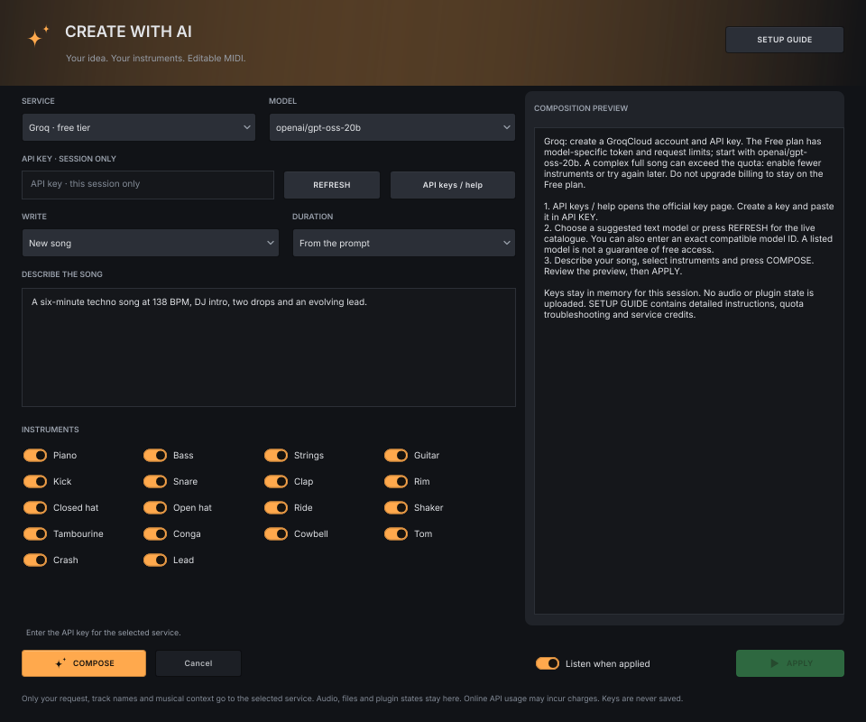
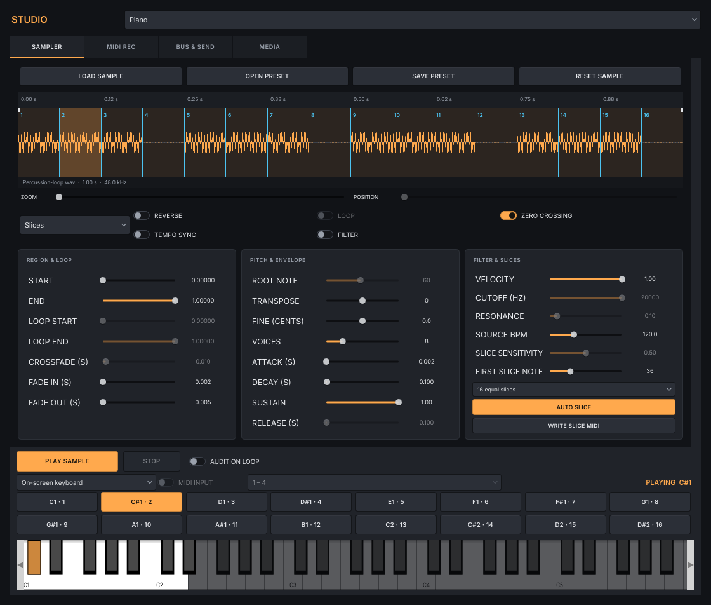
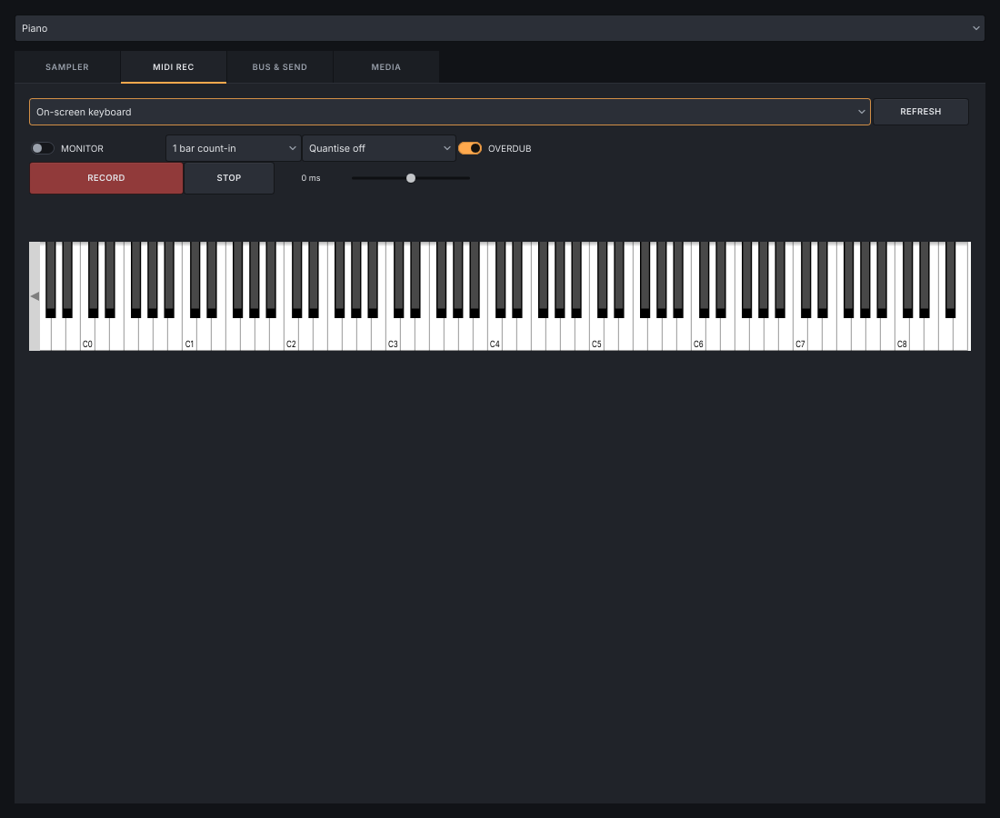
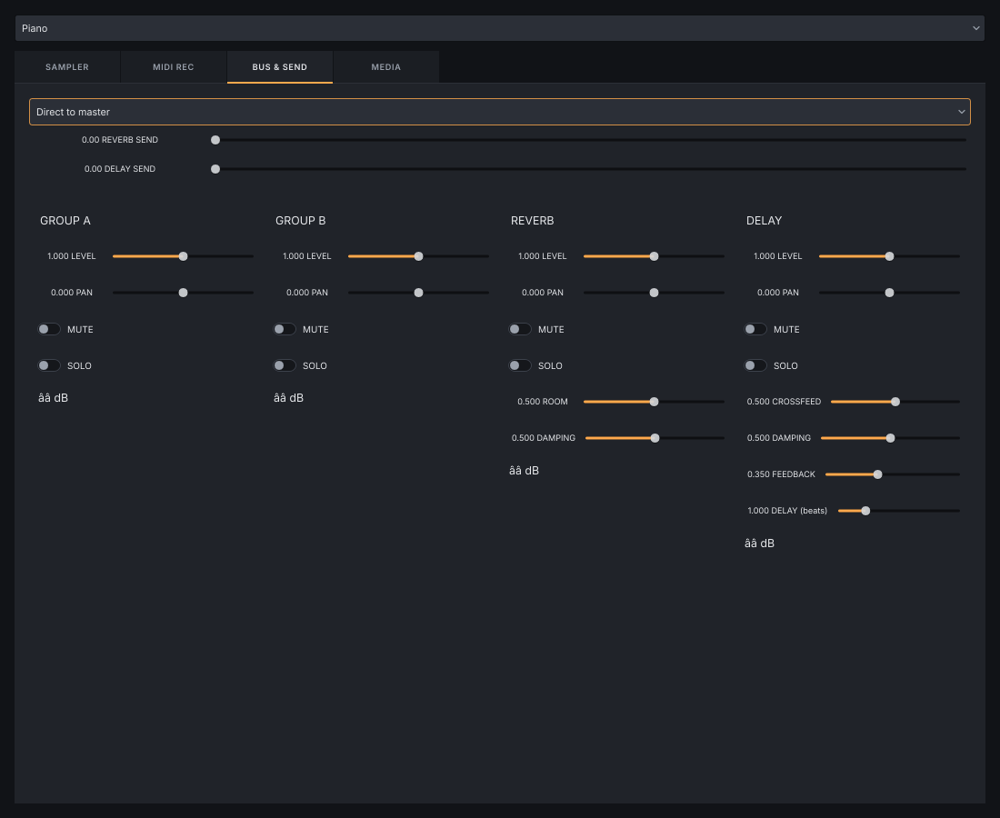
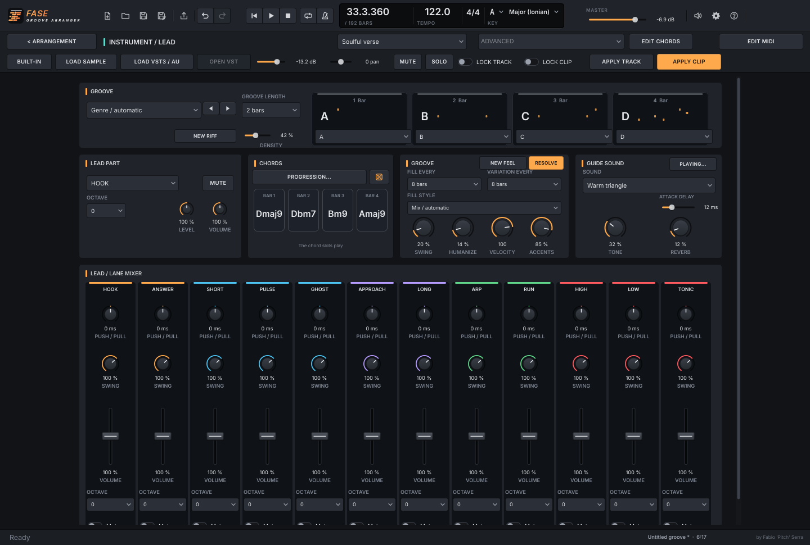

# User guide – Fase Groove Arranger

*🇮🇹 [Versione italiana](GUIDA.md)*

Fase Groove Arranger **writes MIDI** arrangements for soulful, deep, jackin’ house and the other
family genres: pick a key, chords and a groove, listen with the guide sounds, then
**export MIDI or audio to your DAW**, or use your own samples and VST3/AU instruments directly.

**Contents**

1. [Installation](#1-installation)
2. [Your first groove in 60 seconds](#2-your-first-groove-in-60-seconds)
3. [The interface, section by section](#3-the-interface-section-by-section)
4. [Exporting MIDI and audio to your DAW](#4-exporting-midi-and-audio-to-your-daw)
5. [Using instruments in real time](#5-using-instruments-in-real-time)
6. [Building a track: intro, break, drop](#6-building-a-track-intro-break-drop)
7. [Soulful and jackin’ house recipes](#7-soulful-and-jackin-house-recipes)
8. [FAQ and troubleshooting](#8-faq-and-troubleshooting)
9. [Listen to my music](#9-listen-to-my-music)

**Quick access:**

- [Sampler and Studio](#studio-sampler-recording-and-media)
- [Mixer and sends](#mixer-groups-and-sends)
- [Automation](#pan-master-and-vst-parameters)
- [Bars and elapsed time](#bars-and-elapsed-time)
- [Export](#4-exporting-midi-and-audio-to-your-daw)

This guide is current for **0.23.5**. Screenshots show the current interface. The app’s **?** icon opens the same manual with search, contents and enlargeable images.

---

## 1. Installation

This guide covers **v0.23.5** of Fase Groove Arranger. Download your system's package from the [latest release](https://github.com/wsx79/fasegroovearranger/releases/latest).

### Windows installer (recommended)

Open **FaseGrooveArranger-Windows-Setup.exe**, choose English or Italian and follow the same setup wizard as the other Fase Groove apps. It installs the standalone app, guides, privacy/licence notices and Start menu shortcuts; the desktop shortcut is optional. Arranger includes the four Piano, Drums, Guitar and Lead engines, so no Fase Groove plugins or other DAW are required. Windows asks for administrator access for the setup only. Uninstall from Windows Settings; projects, exports and local preferences remain.

### Manual installation (all systems)

| System | Family package | Start |
|---|---|---|
| Windows 10/11 x64 | `FaseGrooveArranger-Windows.zip` | Extract and run `Standalone/Fase Groove Arranger.exe`. |
| macOS 11+, Intel + Apple Silicon | `FaseGrooveArranger-macOS.zip` | Extract, copy the app from Standalone to Applications and open it. |
| Linux | `FaseGrooveArranger-Linux.zip` | Extract and run `Standalone/Fase Groove Arranger`. Preserve executable permissions. |

Builds follow the family layout: one ZIP per platform and the Windows setup, without duplicate versioned archives. Guides, licences and source information are included; validation evidence is kept in a separate Actions artifact. From Actions, extract the artifact ZIP first, then the package inside. Windows setup is unsigned. macOS follows the family signing workflow: ad-hoc signing by default, Developer ID/notarisation when configured. System security prompts may therefore appear, as with the other apps.

### Updates, as in the Fase Groove family

**OPTIONS → SETTINGS → CHECK NOW** checks and downloads the matching package. Automatic checking/downloading is enabled initially; switch it off there to work offline. The family update card shows the downloaded version and release notes, with **INSTALL NOW / LATER / SKIP THIS VERSION**.

Save your project before **INSTALL NOW**. Installed Windows copies run the same setup silently and reopen afterward, preserving the installation folder and preferences. Writable portable copies replace this app in place and reopen; a failed replacement restores the previous files. In a protected folder, the download is shown so you can install it manually. The download is verified against the GitHub release asset's SHA-256 before installation. Nothing is installed without pressing INSTALL NOW; unsaved projects still use the application's normal close confirmation.

Downloads and staging remain in `Downloads/Fase Groove Arranger updates`, or Documents if Downloads is unavailable. Projects, samples, exports and autosaves are not replaced by upgrades. **0.7.0 and earlier:** install this release once manually; their DOWNLOAD button opens the release page. Later versions use the integrated installer/update workflow. On Linux, the network check/download uses system `curl`.

**First launch:** click the **speaker icon** at the top right, then **Audio device / buffer**. Choose your output and buffer. Audio input is enabled from these settings or when you choose to record it in Studio; it is not opened automatically at startup. On macOS, allow microphone access if you want to record an input.

> Start with the guide sound. You can hear and build the whole song before choosing your instruments.

---

## 2. Your first groove in 60 seconds

1. Choose **Soulful** in the genre menu.
2. Choose the groove: song length follows genre and phrase development, without a fixed minute target.
3. Click **NEW ARRANGEMENT**: the intro, main parts, break and outro appear.
4. Press **PLAY** or the **space bar** and listen.
5. Double-click a **piano clip** in the main part. Its large piano roll opens; move a note or change its velocity.
6. Return with **< ARRANGEMENT**. Select **Piano** and choose **BUILT-IN**, **SAMPLE** or **VST / AU** in the inspector. The track gear opens its original musical controls.
7. Click **SAVE**, name the project, then **EXPORT** for WAV, MP3 or MIDI.

Want another take? **REGENERATE TRACK** changes just the selected instrument; **REGENERATE CLIP** changes only that track in that section. **UNDO** takes you back to the previous attempt.

> Found a part you like? Open its panel and enable **LOCK TRACK** or **LOCK CLIP** before trying other takes.

---

New piano regenerations compare the previous rhythmic attacks against draws from the genre generator: velocity and humanisation alone do not count as another rhythm. APPLY and project loading retain the saved take; locked segments remain protected.

## 3. The interface, section by section

### Current interface

Every button of the interface is drawn the same way: **lit (filled) = on**, dimmed = off.
**Amber** marks the main actions, **cyan** transport and automation. Piano, bass, strings, guitar
and drums keep their family colours. Every button has its tooltip. Click a track name to select it in the inspector, its gear to open the instrument panel, and double-click a clip to edit its notes.

The top contains project commands, transport and the controls shared by everyone: **tempo, key and scale**. Below are genre, resulting duration and chord progression. The large area is the song, with sections across and instruments down the side.

| Where | What you find |
|---|---|
| **NEW · OPEN · SAVE · SAVE AS** | Start, open and save your songs. |
| **PLAY · STOP · LOOP** | Listen, return to the beginning and repeat the selected region. The blue cursor shows your position. |
| **Genre and duration** | Genre defines the form. Length follows groove development and complete harmonic phrases; the display shows the result. |
| **PROGRESSION · EDIT CHORDS** | Ready-made progressions and individual chords. HARMONY shows the current progression. |
| **Arrangement** | Each rectangle is a clip: one instrument's notes in one section. |
| **Track name** | Selects the track; its gear opens a separate instrument window with groove, playing, sound and mixer controls. |
| **Double-click clip / E** | Opens the large MIDI editor for just that track and section. |
| **Speaker · gear · ?** | Audio and autosave; options, language and credits; this guide. Icons sit at the top right. |

Colours follow the instruments: **amber** for piano and kick, **cyan** for bass and backbeats, **green** for cymbals, **violet** for percussion and **red** for strings and tom/crash. Guitar playing lanes keep their own colours.

The inspector groups **track**, **sound**, **volume/pan** and **selected clip** into compact cards. Built-in, sample and plugin choices share one row; the plugin editor appears when an external instrument/effect is assigned. Mute, solo, track/clip locks, MIDI editing, regeneration and clip loop retain their actions and undo behaviour. Drag its edge to resize it; double-click restores the 248 px default.

Drag the **lower edge of a track header** to change that track’s height independently (40–240 pixels). Other tracks keep their heights; MIDI durations stay unchanged. Double-click the edge to restore the default height; **Escape** cancels a drag. Heights are remembered between sessions.

**M** and **S** beside a track name mute and solo it without opening the panel. Click the section-name header to start playback from that point. **ZOOM** changes how much of the song you see.

In the arrangement, **double-click a track name** (for example Kick) to select the track and reveal its inspector. Playback and the cursor stay where they are. The inspector’s compact **X** hides it; **I** or the top-toolbar icon restores it. To rename a track, use the name inside its inspector or mixer, or the right-click menu.

The home screen’s **master volume**, **note density**, **Swing** and **Feel** use rotary controls: drag vertically/horizontally or edit their numeric values. Inspector **Volume** and **Pan** are also rotary, with values below; double-click restores 0 dB or centre. Their units and musical effects remain as described below.

### DAW workspace

**DELETE MIDI TRACK** in the inspector, or **right-click → Delete MIDI track**, removes a track added with + MIDI. **UNDO** restores its notes, name, instrument and effect; following tracks keep their data. Generated instrument tracks cannot be deleted.

**+ SECTION** opens a small menu: choose Main, Intro, Breakdown, Build-up, Drop or Outro. The chosen section is inserted after the selected section; UNDO restores the previous form.

After regeneration the zoom fits automatically: the whole song in the arrangement, or the clip duration and generated pitch range in the MIDI editor.

**+ MIDI**, in the corner above the track headers, adds a blank track and opens its piano roll. Write notes by hand, assign a guide sound, sample or VST/AU in the inspector, and use clips, loops, effects, automation and exports as on the other tracks. Up to **32 tracks in total** are available. GENERATE SONG, genre changes and harmony changes preserve these notes. Double-click a track’s **name in the inspector or mixer** to rename it; right-click → Rename is also available. **OPEN VST** opens its assigned external instrument or effect.

The side **INSPECTOR** follows the selected track and clip: volume in dB, pan, mute/solo, generation locks, sample or VST assignment and access to the original instrument panels. The small **panel icon** at its top right hides it and returns its entire width to the arrangement. Reopen it with the **inspector icon in the top toolbar** or **I**. The toolbar icon remains available while scrolling. Drag the panel’s **right edge** to resize its width; double-click that edge to restore the default width. The chosen size is remembered. **INSPECTOR / I** also works. Scroll the inspector if vertical space is limited.

At the right of the **HARMONY** row, above **BUS & SEND**, use **zoom − / slider / zoom +** and **FIT SONG**. Fit shows the complete song duration within the available timeline width, including with the browser open. These view controls do not change MIDI, snap or Undo. Track heights remain as you set them.

The **MIXER** shows the tracks in musical order with a fixed master at the right. Track names (Kick, Snare, etc.) are at the top; the built-in/sample/VST selector is at the bottom. Faders affect audio only, preserving MIDI velocities. Meters clear on pause. The master **CLIP** indicator latches overloads; click it to reset. **COLLAPSE MIXER**, at the top right of the mixer, folds the faders away to give space back to the tracks. A slim bar keeps **SHOW MIXER** available to restore the previous height. **MIXER / F3** also works. Drag the mixer header to adjust its height; double-click restores the default height. The chosen size is remembered; channels scroll horizontally when needed.

When the mixer is closed, its MIXER/levels caption is replaced by a **stereo master meter**, including a dB reading and peak hold. It follows real output audio. Reopening the mixer removes this compact meter and restores the strips and their master channel.

**Coloured vertical lines at section starts** match each section header. They mark the entry of Intro, Main, Answer and the other parts without filling the whole section.

- **Click a clip or the grid** to select without moving the cursor or interrupting playback. **Click the section-name header** to place the cursor and immediately listen from that position. The numbered ruler still positions the cursor and controls the loop. **Double-click** or **E** opens the full MIDI editor.
- **Right edge of a clip**: drag to shorten or extend just that loop in beat steps; **Shift** allows quarter-beat steps. MIDI repeats with its timing and velocities intact. Shortening retains the source, so extending restores it. You can cross a section boundary; the extended clip takes precedence over covered parts on the same track, preventing doubled notes.
- **Right edge of a section header**: resize the guide in whole bars. Intro, Main, Break and the following guide labels move; clips, locators and volume automation stay at their musical times. Right-click the header to rename it, change its role, insert, duplicate, reorder or delete a guide section. **Escape** cancels a drag; **UNDO** restores it.
- **Drag a clip** to move it along the timeline or onto another track; **Alt-drag** copies it. The original position becomes a gap when moving. Destination overlaps are replaced while outside fragments are retained. The target track keeps its sound; drum MIDI maps to its lane. **Shift-click** selects more clips on the same track; **Ctrl/Cmd+A** selects all its clips.
- **Cut, copy, paste, split, duplicate and delete** are in the clip's right-click menu and on the keyboard. Paste uses the cursor; click the numbered ruler, including after the current ending, to choose its position. Split cuts the selected clip at the cursor; duplicate places copies after the selected range. Delete leaves a gap. Use **Ctrl/Cmd+X / C / V**, **S or Ctrl/Cmd+E**, **Ctrl/Cmd+D**, and **Delete / Backspace**.
- **SNAP** chooses bars, beats, half/quarter beats or free timing. Hold **Shift during a drag** for free timing. Right-click empty track space for **Create empty MIDI clip**. Double-click a clip to edit its notes in the original full instrument editor.
- **Click the bar ruler** to seek precisely, as in the MIDI editor ruler; **Shift-drag** sets the loop range. Both locators remain visible with LOOP off.
- The toolbar above the timeline holds **SNAP**, **ZOOM SELECTION**, **LOOP SELECTION**, **FIT SONG / F** (complete form), **FOLLOW** (scrolls during playback) and **AUTOMATION**; on its right **GUITAR LEADS**, then **INSPECTOR / I**, **BROWSER / B** and **MIXER / F3** toggle the panels.
- Drop a MIDI file or personal sample on a track row to target that track.

Moving a multiple-note selection in the piano roll preserves spacing at clip and MIDI pitch boundaries. Guide edits preserve loop locators and automation. Clip positions, loop sources and gaps save in .fga format 2; format 1 projects still open. Reopen edited timelines with version 0.6.0 or later.

### Compose with AI

The amber **AI COMPOSER** button, with sparkles in the arrangement toolbar, opens a separate composer window. AI writes MIDI notes and song sections; your **assigned guide sounds, samples and VST/AU instruments** play them. Every note remains editable.

1. **Ollama · local, no API key** is the initial choice: no API key or subscription is needed. Install [Ollama](https://ollama.com/download) and open it on the same computer as Arranger. Download a text model, for example `ollama pull qwen2.5:7b` (about 4.7 GB; allow sufficient RAM and disk space). Models are not bundled with Arranger. **INSTALL / HELP** opens the setup page and shows instructions in the preview.
2. The server is normally `http://127.0.0.1:11434`. Arranger checks the connection and populates **MODEL** with local models actually installed on that server. **CHECK** refreshes the list after a download or address change. Addresses such as `127.0.0.1:11434` and those ending in `/api` are normalized. When Ollama is stopped or has no models, the preview explains the next step and **COMPOSE** remains disabled. Typing a model name does not install it. Cloud models are excluded from the local list. A server on another computer receives the musical context at that address. Alternatively select OpenAI, Anthropic / Claude or Google / Gemini: these require a service API key, kept only in memory for the session, and may charge for usage. Chat subscriptions do not necessarily include API access.
3. Choose **New song** to replace the entire MIDI arrangement while retaining instruments and mix, or **Edit selected tracks** to rewrite only enabled tracks while preserving the form, tempo and other parts. Tick the instruments to use. Locked tracks cannot be enabled; targeted editing preserves locked clips. Unlock all tracks and clips before creating a new song.
4. Describe the result: “A six-minute techno song at 138 BPM, DJ intro, two drops, hypnotic bass and an evolving lead.” **From the prompt** takes duration from your request; alternatively choose minutes from the menu. AI compositions support 30–300 BPM, beyond the thirteen preset genres. Duration fits the nearest whole bar.
5. Press **COMPOSE**. Generation runs in the background; **Cancel** stops it without changing the project. The preview lists the description, duration, sections and note counts by instrument. Invalid or incomplete responses cannot be applied.
6. Press **APPLY**. **Listen when applied** starts playback; **UNDO / Ctrl+Z** restores the previous version. New-song composition clears old automation so fades from the previous form cannot affect the new song. Targeted editing preserves automation. If the project changed while the model was working, regenerate the preview to include your latest edits.

To ask “change only the bass”, choose **Edit selected tracks**, enable only Bass, and describe the change. Context includes harmony and excerpts of the current MIDI, plus track/section names; file paths, audio and plugin states are never uploaded. API keys are never written to projects, preferences or temporary files.

Quality depends on the model. For authentication errors, check the key and model access; for quota errors, check the service’s limits and billing. Small local models may return invalid MIDI: simplify the request or use a more capable model. Traditional **APPLY/REGENERATE** commands still use the original engines and can overwrite AI notes; lock parts you want to retain.

### Sample browser

**BROWSER / B** opens the sample browser on the right of the arrangement; the mixer and timeline make room for it. It remembers your folders, favourites and the last folder you visited, also after a restart.

- **ADD FOLDER** adds a sample folder to the list at the top. Click a folder to open it, the **star** to make it a favourite (favourites stay first). Right-click a folder to **Change folder…**, **Remove from the list** or show it in the file manager. A folder that is not reachable (unplugged drive) is marked **offline**.
- The **breadcrumb** shows where you are inside the saved folder; click a part to go back up. **◀ ▶** move through the folders you visited, **↑** (or Backspace) goes up one level.
- **Search** filters by name (every word must match). The menus choose the type (all audio, WAV, AIFF, FLAC, OGG or all files) and the order (name, date, size, length); the arrow reverses it. Folders always come first.
- Select a file to see its duration, format, sample rate, channels and size. **▶** plays a preview (up to 30 seconds, it also works with the song stopped); **AUTO** previews every file you select.
- **Double-click**, **Enter** or **LOAD · TRACK** loads the sample into the selected track's sampler. **Drag** a file onto a track row to load it there: the row lights up while you drag. Undo restores the previous sound.
- The arranger's sampler reads WAV, AIFF, FLAC and OGG. Other audio files (MP3, M4A…) are listed with **n/a** and a clear message instead of being loaded.

Folders are read and audio headers measured in the background, so the interface stays responsive even with thousands of files; nothing runs while the browser is idle.

### Studio: sampler, recording and media

**STUDIO**, with its waveform icon next to **AI COMPOSER**, opens an always-on-top window. Close it with X; reopening centres it. When a track uses a **Sample**, its inspector shows **OPEN SAMPLER**. The sampler target menu lists only sample tracks, including samples needing relinking. MIDI recording and media retain access to all tracks; changing tabs during a take cannot change the recording destination.

#### Prepare and edit a sample

Drop an audio file from the browser or operating system onto the waveform, or press **LOAD SAMPLE**. Numbered markers identify slices.

**SAMPLER.** Load WAV, AIFF, FLAC or OGG samples up to 30 minutes and 512 MiB decoded per file. Drag the nearest waveform edge to trim start/end; **mouse wheel** and **trackpad pinch** zoom around the pointer; horizontal gestures or **Shift+wheel** move the view. **Double-click** fits the whole sample. **ZERO CROSSING** snaps an edit to a nearby zero crossing. Start/end values are fractions of the sample, from 0 to 1; fades and envelope times are seconds.

- **Classic / gate** follows MIDI note-off; **One-shot** plays the complete region even for short notes. Use One-shot for crashes and cymbals.
- **LOOP** repeats the loop region in Classic mode; crossfade softens the seam. **REVERSE** changes playback direction.
- Root note, transpose and fine tuning set pitch; **VOICES = 1** makes the instrument monophonic. Attack, decay, sustain and release shape the envelope. The low-pass filter has cutoff and resonance; **VELOCITY** sets sensitivity to note strength.
- **TEMPO SYNC** separates duration from pitch. Set the sample’s original **SOURCE BPM**; playback then follows project tempo. Without sync, transposition also changes playback speed.
- **AUTO SLICE** immediately maps playable slices. Choose **Transients** or **4 / 8 / 16 / 32 / 64 equal slices**; slicing respects the trimmed region and maps consecutive pitches from **FIRST SLICE NOTE**. Selecting **Slices** with no markers detects them automatically. Shift-click adds a marker; right-click removes the nearest. Pads and keyboard remain visible together; unmapped keys are dimmed. Banks contain 16 pads. **WRITE SLICE MIDI** replaces clip notes with triggers at their original rhythmic positions; Undo restores the clip.
- **RESET SAMPLE** restores trim, loop, envelope, filter, pitch and slices to defaults, resets the root and eight-voice limit and fits the waveform. It preserves the sample file, MIDI notes and track mix as one undoable action. Sample instruments on drum tracks preserve played MIDI pitches in every mode.
- The keyboard stays at the bottom when the controls scroll. Play with the mouse or **A W S E D F T G Y H U J K** after focusing it. For a hardware keyboard, select its input and enable **MIDI INPUT**. Song MIDI, keyboard and pad notes light up and their names appear on the right. The indication also follows one-shot tails after key release.
- Controls are grouped into five modules: region/loop, amplitude envelope, tuning/playback, filter and slice/sync. Rotary controls retain the original parameters and their numeric values underneath remain editable. Tooltips explain actions and units when you rest the pointer over a control. They follow the global tooltip preference and work in Studio’s separate window.
- **SAVE PRESET** writes a `.fgs` and a neighbouring sample folder. Move both together. **OPEN PRESET** restores sample, root and settings. Project saving and Undo/Redo also preserve sampler settings.

**Safe scrolling.** In Studio, wheel and trackpad gestures navigate the view without changing levels, parameters or menu choices underneath the pointer. Drag a control or type in its numeric field to edit a value. Waveform zoom and panning remain available.

#### Audition and tune the sample

**Sample audition.** Press **PLAY SAMPLE** to hear only the selected source with the current sampler settings, before track volume, mute, effects and buses. Song playback stops while retaining its position. **AUDITION LOOP** repeats the region for continuous filter, pitch, envelope and trim editing; it does not change the sampler LOOP parameter. **STOP** stops immediately. Without repeat, the region ends naturally; an enabled internal sampler loop continues until STOP. In Slices mode, audition plays the first slice; use pads or the keyboard for the others. The auditioned note is highlighted below. Changing sample or tab, closing Studio, starting the song or recording stops audition. These three controls do not change project data, MIDI or Undo history.

**Sample tuner.** During isolated audition, MIDI keyboard playing or song playback, **DETECTED PITCH** measures the selected sampler audio before track effects and shows its nearest note, cents offset and frequency in Hz. **+** means sharp, **-** means flat; the reference is A = 440 Hz. Adjust **TRANSPOSE** in semitones and **FINE (cents)** for fine tuning: the reading follows the processed sample sound. Octave numbering matches the Studio keyboard. The MIDI NOTE indication remains the MIDI trigger key, which can differ from the sample’s actual pitch. The tuner is intended for stable monophonic sounds, approximately 35–1600 Hz, with a short analysis window; noise, crashes, chords and transients may show **No stable pitch**. The last stable pitch is held for one second after playback ends, labelled **LAST PITCH**, so short samples remain readable; then a dash appears.

**If the kick becomes quiet after an edit.** Try **UNDO** first. For a sample source, select Kick and press **RESET SAMPLE**: it preserves the file, MIDI and mix. If it remains quiet, also check track volume, mute/solo, automation, routing and the assigned group level/mute, since sampler reset preserves the mix. Identifying the exact cause requires the project state; low level alone does not establish an audio-engine defect.

#### Record MIDI

**MIDI REC.** Select an available MIDI input or use the on-screen keyboard. REFRESH discovers devices connected after opening Studio. **MONITOR** auditions input with transport stopped. Select zero, one or two count-in bars, quantisation off or quarter through thirty-second notes, and overdub or replacement. Millisecond correction compensates recording timing. Press **RECORD**, then **FINISH TAKE** to keep playing or **STOP** to stop. Closing Studio finishes the take. Editing commands are protected during recording; main-window **STOP** and **Space** remain available to finish the take. The Studio button can reopen its window; the take is one undo step. Quantisation moves onsets while preserving durations; sustain pedal becomes note duration. Notes and velocity are recorded; pitch-bend curves and controller automation are not recorded. Locked tracks and clips are protected.

#### Record audio and use a take

1. Open **STUDIO → RECORDING** and choose the target track in the top menu. The **AUDIO RECORDING** card is separate from MIDI recording.
2. Choose **Audio input** or **Master mix**: capture the input device or the audible song output. First configure an audio device using the speaker icon → **Audio device / buffer**; enable the input channels you need.
3. Position the cursor on the ruler, press **RECORD AUDIO**, and choose a WAV destination. Transport starts too. The file is stereo 24-bit at the device sample rate.
4. Press **FINISH TAKE** to complete the WAV; closing Studio also finishes the take. Finishing does not return song position to the beginning.
5. Press **USE AUDIO TAKE** to add a new sample track with a clip at the recorded position. The section guide is extended if needed. **UNDO** removes the track while keeping the WAV on disk.

**Master mix** takes are imported **muted** to avoid doubling the song. Unmute when you want to hear the take, accounting for the original mix. Its WAV already includes master processing; the imported track then follows the current mix. Recording remains continuous through loop boundaries: disable LOOP to hear a long take linearly.

Alignment includes plugin latency and, for input recording, device latency. Preroll before zero is excluded using sampler trim without cutting the WAV. Takes shorter than the latency preroll or larger than sampler limits remain on disk; Studio explains why **USE AUDIO TAKE** is unavailable. A device/rate change or write failure interrupts the take with a warning. MIDI and audio cannot record together.

**BOUNCE TRACK** saves the selected track’s sound to WAV, with effects, tails and latency compensation. It renders the track rather than recording a new input take.

**Latency and level.** Studio displays compensation and capacity: **262143 samples**, about 5.46 s at 48 kHz. Plugins exceeding the limit trigger a warning. MIDI recording’s millisecond correction fine-tunes your performance timing. Input overflow is reported: check the take without losing unrelated tracks’ playback. Live master output retains float peaks; if **CLIP** lights, lower levels before PCM or MP3 export.

Automatic backup waits for stopped transport and quiet audio. Explicitly saving a VST state can cause a short pause, depending on the plugin. Audio input continues to be captured during that pause; a master recording retains the actually audible output, including silence.

#### Manage samples and portable projects

**MEDIA.** **COLLECT & SAVE** writes a portable project and neighbouring `.media` folder, copying and verifying samples while preserving originals. Identical samples are deduplicated. Move project and folder together. **RELINK SAMPLES** searches a folder recursively, matching content fingerprints where available, otherwise requiring a unique filename. Unresolved samples remain missing. External plugins are not copied: install them separately on the destination computer.

A legacy project relinked by filename alone displays an unverified-content warning: audition the sample before keeping the change. **Cancel** requests a safe stop during collection or search; an interrupted collection preserves the previous project and removes partial copies. Relative project/preset sample paths stay inside their own folder; external samples can use absolute paths.

### Mixer: groups and sends

Open **BUS & SEND** from the mixer header. The panel stays on top, closes with X and reopens centred. Studio retains sampling, recording and media management; mixing controls are in the mixer.

- Each channel’s **M / GA / GB** chooses its output: direct master, Group A or Group B. Groups collect routed tracks and have their own level, pan, mute and solo.
- **A** toggles the shared reverb send; **B** toggles the shared delay send. A lit button means its send is above zero. The first activation uses 25%; subsequent activations restore the last level used in that session. The project saves the current level, including zero when off.
- Select any track in the panel and adjust its two percentages independently. **A - REVERB** and **B - DELAY** are effect returns, separate from track Groups A/B. All four buses have editable name, level, pan, mute and solo; returns also expose room/damping and delay time/feedback controls.
- An idle meter reads **Silence**: it is receiving no signal, which does not necessarily mean mute. Other readings are numeric dB. Wheel and trackpad gestures cannot change values accidentally.

Studio and Bus & Send share flat dark surfaces, knobs, chips and a single orange accent. Mapped slice keys carry an orange mark before playback. Recording and Media use the same theme.

Each strip has one editable title, a Pan knob, bottom-aligned vertical fader/meter and **M / S** buttons. Amber identifies effect returns and active values. Room/Damping and Crossfeed/Damping/Feedback/Delay knobs sit above the Reverb and Delay strips; groups retain the same fader area. Track, output and two rotary sends share the upper source panel.

Faders display dB: **0 dB = unity gain**, bottom = silence; double-click restores 0 dB. Stored values remain linear and are not changed by opening or refreshing the panel. The reading below the meter is the measured signal level, distinct from fader position. Pan displays **C** at centre and **L/R** as percentages: type **L25**, **R25** or **C** in its value. Values below the knobs and faders remain editable.

Sends follow track and group levels; master controls returns too. Use song Play or the track’s MIDI keyboard to hear them: opening Bus & Send stops isolated dry sample audition. Song playback does not start automatically. Routing, sends and bus controls support Undo and preserve MIDI. Playback and export retain the same audio graph; stems include their shared-effect contributions.

### Navigation and selection

- **Wheel on the ruler** or **Ctrl/Cmd + wheel** over clips/notes: zoom around the mouse pointer. **+ / −** zoom around the centre of the visible area. The MIDI editor also has a ZOOM slider.
- **Wheel** scrolls vertically; **Shift + wheel** scrolls horizontally. Horizontal trackpad gestures also scroll horizontally. **Middle-button drag**, in the arrangement, pans both axes. Manual navigation turns FOLLOW off; enable it again to follow playback.
- **ZOOM SELECTION / Z** frames the selected clips; in the MIDI editor, **Z** frames selected notes, or the whole clip if no notes are selected. **FIT SONG / F** restores the complete arrangement view.
- **LOOP SELECTION / Ctrl/Cmd + L** sets both playback locators from the selected clips. In the MIDI editor it uses the selected notes, or the complete clip. This changes playback only and can be undone.

### Transport & tempo (top)

| Control | What it does |
|---|---|
| **⏮ ▶/❚❚ ■** | Return to the start, play / pause, stop. The space bar toggles play / pause. |
| **TEMPO** | Changes song playback speed. Normally follows the genre range; AI songs with free tempo allow 30–300 BPM. Bars and notes remain unchanged while duration in minutes changes. |
| **Position** | Bar : beat / song length in bars, next to the TRANSPORT title. |
| **LOOP** | Repeats the chosen region; LOOP CLIP repeats the selected editor section. |
| **CLICK** | Metronome while playing (live only, never exported); same as **C**. |

### Bars and elapsed time

Click the **position number or the small bar-count legend** next to the metronome. The transport alternates **bars.beats.ticks** and **minutes:seconds.milliseconds**. Time mode shows **remaining time** below in grey; durations above an hour also include hours.

The **arrangement** ruler switches from bar numbers to song times calculated from the current BPM. Lines still follow bars and beats: **metre, snap, notes, loops and automation stay unchanged**. The piano roll retains its musical references. Time follows song position, so it moves back when a loop restarts. Click again to restore bars; the choice is remembered locally.

Songs use **4/4**, with four beats per bar. The transport indicator is not a time-signature selector.

### Progression, Harmony & Scales and Groove

**The song has one shared key and scale.** Piano, bass, strings, guitar and lead use the same progression. There is no need to LINK the individual instruments.

| Control | What it does |
|---|---|
| **Key / Scale** | The root and mode, at the top beside tempo. |
| **PROGRESSION** | A progression from the Fase Groove Piano library. Some also choose a suitable scale. |
| **NEW CHORDS** | Prepares another degree progression in the selected scale. |
| **EDIT CHORDS** | Change each chord: a scale degree, or major, minor or dominant on a chromatic root. One to eight chords, with a shared harmonic duration. |
| **Extensions / Voicing** | Chord colour and piano note layout; Extensions applies immediately to unlocked harmonic parts. |
| **DENSITY** | From a few notes to a busier groove. |
| **SWING** | Moves alternating sixteenths, from straight towards shuffle. |
| **FEEL / HUMANIZE** | Small timing and velocity differences. |

**Tempo** changes playback speed immediately. Other choices prepare the next generation; the notes you have written stay in place until you apply them.

Inside an instrument panel, **APPLY TRACK** or **APPLY CLIP** applies its parameters while keeping the current groove take. The **NEW** buttons in the arrangement choose a different take.

> After changing the key or progression, regenerate the relevant harmonic instruments together. A locked part keeps its notes, even when the rest of the song changes harmony.

### Tracks: extended piano, bass, strings and drums

The first thirteen tracks are the drum pieces: **Kick, Snare, Clap, Rim, Closed hat, Open hat, Ride, Shaker, Tambourine, Conga, Cowbell, Tom, Crash**. Then come **Bass, Piano, Strings, Guitar and Lead**. The guitar stays together on one track.

**INSTRUMENT PANEL** in the inspector, or the track’s **gear**, opens a separate resizable window. The arrangement or piano roll stays visible and playback continues. Choose how to hear it at the top; below are groove, feel, playing and fills. **EDIT MIDI** opens the notes; **< ARRANGEMENT** returns to the song.

| Instrument | Where to start |
|---|---|
| **Piano** | Groove, gate, register and strum; then movement, top line and range to refine the right hand. |
| **Bass** | A bass line and its feel: classic, sub or sub with gaps on the beat. |
| **Strings** | A strings style, from sustained support to a rhythmic part. |
| **Drums** | Just the selected piece: groove, velocity, MIDI note and pocket. |
| **Guitar** | Strums, let ring, room for band, pushes and the twelve-lane mixer. |
| **Lead** | Monophonic motifs, answers, arpeggios and runs; attack delay, four synth sounds and the twelve-lane mixer. |

**Piano note range (Harmony & Scales):** drag the left handle to set the lowest chord note and the right handle to set the highest. Both handles follow the mouse; the highlighted interval shows the allowed range. The unlocked Piano MIDI updates immediately. Undo restores the previous range and notes.

Guitar-part **VOLUME** faders control the guide sound; the selected part’s **LEVEL** changes MIDI dynamics on generation. Part mutes also affect playback of existing notes. MIDI export preserves the clip’s notes.

**VST** and **INSTRUMENT PANEL** windows stay on top until manually closed. Each reopening centres them on the screen.

#### Lead

Lead uses the same melodic engine and four guide synth sounds as [Fase Groove Lead](https://github.com/wsx79/fasegroovelead). Its twelve phrase lanes generate one melodic voice; passing notes follow the shared key and scale, strong beats follow the chord slots, including their shared half/one/two/four-bar duration. Groove, density, new riff/feel, A–D order, fills, variations, lane levels, mutes, timing and octave controls work like the original instrument. ATTACK DELAY is in milliseconds; PLAYING offers held hooks, upper register and anticipated harmony. Lead has its own pitched MIDI editor, sample/VST/AU assignment, effect, automation and stems. Its MIDI export uses melodic channel 5, separate from the drum channel.

**Global octave** shifts the entire Lead melody from −2 to +2 octaves, relative to each lane’s own octave. It is stored in the project and used for MIDI and audio export.

Existing seventeen-track projects load with an empty Lead track appended. Projects with fewer tracks are migrated too: saved parts retain their instrument assignments and missing slots remain empty and muted. Existing track IDs, notes, plugins, mix and automation stay intact. Regenerate Lead explicitly to add a melody to an old song; manual MIDI edits remain editable like the other pitched instruments.

### Genre sound palettes

Genre also prepares the original guide sounds, kit, tone, voicing and band balance. The guide bass stays centred and dry; guitar and strings leave phrase space for the theme. Personal samples and VSTs retain their assignment and mix. Settings prepare the next MIDI generation; audio controls change immediately. Old projects retain their stored presets until a genre is selected again. See [genre sounds and roles](https://github.com/wsx79/fasegroovearranger/blob/main/docs/GENRE_SOUND.md).

#### Piano: extended view

Piano uses the extended editor’s adjacent panels: Harmony & Scales, Circle of Fifths, Groove and Guide Sound. Rhythm/Velocity and Performance are below. Key, scale and transport remain in the DAW toolbar. **ADVANCED** jumps to the panel sections.

It includes **per-chord inversions**, independent riff/feel seeds, **NEW FEEL**, sustain/expression CC64/CC11, A–D order and locks, a 32-step rhythm grid and individual velocity faders. Click a step to cycle rest, note, accent, ghost, push or hold. Drag a fader for velocity; double-click restores automatic dynamics. **RND PIANO** changes rhythm while respecting locked segments; **RND VELOCITY** changes dynamics only.

**DNA**, **MORPH**, **A/B**, **VARIANTS** and the **CIRCLE OF FIFTHS** use the original musical tools. Results prepare settings: APPLY TRACK / APPLY CLIP writes the notes. A and B also audition a clip with two voicings; UNDO reverses the trial. IMPORT MIDI estimates chords and rhythm; check the result before regenerating. **LEARN** accepts a chord when all keys are released, after you choose a MIDI input.

**EDIT CHORDS → Each chord** sets the shared harmonic duration: half, one, two or four bars. Guide-sound pump provides rate, release and **Tempo / Kick MIDI** source. Kick MIDI follows notes in the Kick track; it is not an external audio input.

**OPTIONS → SETTINGS → Language** selects English, Italian, Spanish, French, German or Portuguese. Control tooltips can be toggled in the same panel. Both preferences stay on this computer; complete manuals are available in Italian and English.

Panels show only controls used by the selected mode: named bass lines and independent string pads hide the piano rhythm grid and its editing tools. Selecting a bass mode or string stabs that follow the grid restores those tools. Tone and guide effects appear only with the built-in instrument; gain, pan, mute, solo and routing stay in the track toolbar.

#### Guide sound, sample or VST

| Button | What you choose |
|---|---|
| **BUILT-IN** | Return to the guide sound. Piano and bass have seven keyboard tones; strings, four guitars and four drum kits have their own sounds. |
| **LOAD SAMPLE** | Your WAV, AIFF, FLAC or OGG, up to 30 minutes and 512 MiB decoded per file. The file stays on disk; the project remembers its path. The sample browser (**B**) does the same with preview and drag & drop. |
| **LOAD VST3 / AU** | Opens the plugin browser. FaseGroove engines are the first group; other plugins are grouped by manufacturer. Search, favourites and recents work as in the groove browser. A click loads an instrument or one insert effect. |
| **OPEN VST** | The loaded instrument's own interface. When an effect is also loaded, choose instrument or effect. |

**Plugin catalogue.** Open **OPTIONS → SETTINGS → PLUGINS…** to see the standard folders, choose one personal folder, and rescan. Subfolders are included. Windows searches the system Common Files/VST3 and user Programs/Common/VST3 folders; macOS searches the system and user Audio/Plug-Ins/VST3 folders; Linux searches `~/.vst3`, `/usr/lib/vst3` and `/usr/local/lib/vst3`. macOS also lists Audio Units registered with the operating system; install `.component` bundles in its standard Components folders using the vendor installer.

The first launch scans automatically. Every later launch checks the same standard folders and the one custom folder in the background; the saved KnownPluginList is immediately available from **LOAD VST3 / AU**. Names show Instrument or Effect and the format. New or updated VST3 bundles are inspected again; unchanged bundles reuse the catalogue. Removed plugins disappear from the list, while project assignments remain available for relinking. **OPEN VST3 FILE…** still lets you choose a bundle directly.

Plugin inspection runs in a separate process, with a timeout. Failed or interrupted checks are skipped and counted; **RETRY FAILED** checks them again. **CANCEL** stops the current scan. Scanning does not change tracks, MIDI or instrument assignments. The catalogue and folder preferences are local to your user account. Instrument playback continues to use native plugins in the app process; only discovery is isolated.

**GAIN, PAN, MUTE and SOLO** belong to the track. **TONE, REVERB, CHORUS and PUMP** change only the guide sound; use your VST's controls for its sound. The groove controls still write the MIDI sent to it.

A pitched sample starts with root MIDI 60; drums use the piece's note. **Right-click the track name → sample root** changes it. This is a single sample transposed across the track's notes, not a multisample library.

**MIDI Learn:** after eight chords, learning returns to the first slot while retaining the full progression. In **Voicing Coach**, **APPLY A / APPLY B** identifies the current choice; changing either menu updates it immediately, including after an audition.

### Piano roll and rhythm grid

Double-click a **clip** to open the full editor. Choose which part to edit in the section menu; **LOOP CLIP** repeats it while you work. Each editor shows only its own track. A drum piece has one row.

| Action | Result |
|---|---|
| **Click empty space** | Add a note on the grid. |
| **Drag a note** | Move it in time; in the pitched piano roll, also change its pitch. |
| **Drag its right edge** | Change the length of pitched notes and drum hits. |
| **Alt + drag vertically** | Change velocity without moving the note. |
| **Shift + click** | Add or remove a note from the selection. |
| **Right-click / DELETE / Backspace** | Delete a note. In the guitar lane view, right-click removes the strum gesture. |
| **Ctrl/Cmd + A** | Select all notes in the clip. |
| **QUANTISE** | Align to the selected grid: 1/4, 1/8, 1/16 or 1/32. |
| **−12 / +12** | Transpose pitched notes by an octave. |
| **VEL** | Change selected-note velocity; with no selection, set it for new notes. |
| **COPY / PASTE, Ctrl/Cmd + C / V** | Copy selected notes, or the whole clip. Paste starts at the cursor on the grid inside this clip; if the cursor is elsewhere, paste starts at zero. Relative note spacing is retained. Extend the clip first if the complete phrase will not fit. |
| **Ctrl/Cmd + X / D** | Cut selected notes / duplicate them directly after the selected phrase, preserving spacing. Duplication needs enough room inside the clip. |
| **Left / Right** | Nudge selected notes by one grid step; Shift uses one bar. The group stops together at the clip boundary. |
| **Up / Down** | Transpose selected pitched notes one semitone; Shift uses an octave. Drum pitch stays fixed. In guitar lane view, move the selection by one lane. |

In **Drums**, drag a hit’s right edge to change its MIDI duration. Handwritten hits start with the generator’s gate lengths: **Crash** uses two beats. Guide drums and drum samples finish their natural tails even with short notes; VST instruments receive the chosen MIDI duration.

Quantise and transpose affect the selection, or the whole clip when nothing is selected. **ZOOM** opens up timing detail. **Escape** returns to the arrangement.

**IMPORT MIDI** replaces notes in the selected clip. Dropping a `.mid` onto a timeline row targets its clip, or creates a clip at the drop position in an empty lane. A sample drop changes the destination row’s instrument. These drops do not seek or stop playback. Project tempo stays as set in the Arranger. In a drum track, imported notes are mapped to just that piece. **UNDO** restores the previous clip.

### Guitar part and mixer

Edit the guitar as in Fase Groove Guitar: **twelve ways of playing the same chord, all on one track**.

| Lane | What it plays |
|---|---|
| **DOWN / UP** | Down-strums of the chord and up-strums on the high strings. |
| **STAB / CHANK** | Short chords and very short funk chops. |
| **SCRATCH** | A muted percussive hit to fill rhythmic spaces. |
| **SLIDE / SWELL** | Slides into the chord and gradually swelling entries. |
| **ARP / LICK** | One string at a time and phrases over the chord. |
| **OCTAVE / POWER / ROOT** | Octaves, power chords and low-string roots. |

Click a lane to add a gesture on that bar's chord. Its notes select and move together. **NOTES / LANES** switches to the piano roll when you want to edit individual notes.

### Who carries the progression?

**GUITAR LEADS** in the main arrangement toolbar changes the roles without opening the engine. The guitar panel and editor offer the same switch. With **SOLISTA** enabled, guitar carries the groove and piano leaves space, playing accompaniment and answers. Piano and guitar update while respecting generation locks. **UNDO** restores the previous roles.

The twelve lanes sit side by side in the mixer: **level, octave, mute, swing share and push/pull**. Push/pull is in milliseconds: negative is earlier, positive later.

> Try **Room for band** to leave the bass its space. For a more percussive guitar, shorten strums and reduce **Let ring**. Listen with the piano, not only in solo.

### PROJECT, undo and redo

**SAVE / SAVE AS** writes a `.fga` project: sections, notes, parameters, locks, mixer and VST state. Samples and plugins stay at their paths; keep the files used in the song.

Autosave becomes due about once a minute after edits. During playback, recording or export it waits for a safe stopped moment, then writes without blocking the controls. **speaker icon → restore autosave** opens it as work to save under another name. UNDO retains up to forty steps during the session.

When closing the app, opening a project or starting a new song, **Cancel** leaves an active take untouched. **Save** asks for a destination when needed; the requested action continues only after a successful save. Cancelling the file selection cancels navigation; a write error leaves your work open.

Projects accept up to **256 MB** and **2 million notes** in total. MIDI import is limited to **64 MB** and the project’s remaining note budget. Overly nested documents and relative sample paths outside their project/preset folder are rejected without replacing your current work.

### Shortcuts

| Keys | Action |
|---|---|
| **Space** | Play / pause. |
| **Escape** | Return from the editor to the arrangement. |
| **Ctrl/Cmd + S** | Save. |
| **Ctrl/Cmd + Shift + S** | Save as. |
| **Ctrl/Cmd + Z** | Undo. |
| **Ctrl/Cmd + Shift + Z / Ctrl/Cmd + Y** | Redo. |
| **Ctrl/Cmd + A**, in the editor | Select the clip's notes. |
| **Delete / Backspace**, in the editor | Delete the selection. |
| **Home** | Playhead to the start. |
| **L** | Loop on / off. **Ctrl/Cmd + L** loops the selection. |
| **C** | Metronome on / off (live only, never exported). |
| **B** | Sample browser on / off. |

In this guide, **Ctrl/Cmd + F** focuses search. The arrows beside search move between results; **A− / A+** changes text size. Click a screenshot to open it larger.

### OPTIONS: settings, language and credits

**OPTIONS → SETTINGS** follows the same panel as Piano, Drums and Guitar: language, interface size, tooltips and updates. **ABOUT** contains credits and SOURCE CODE, Ko-fi, PayPal and Spotify buttons. Audio, guide, privacy and licences open from the buttons below the preferences. This Markdown document is the source guide, as in the other family apps.

> This guide uses English or Italian control names; with the interface in the other language,
> the translated label is in the same position. Chord, mode and groove names stay unchanged.

---

## 4. Exporting MIDI and audio to your DAW

| Export | What you get |
|---|---|
| **MIDI** | The multitrack song, one track or separate files for all tracks. Includes tempo and section markers, not the sounds. |
| **WAV** | Mix, one track or all stems, in 24-bit stereo. Use this for further mixing. |
| **MP3** | Mix, one track or all stems, stereo 320 kbps / 44.1 kHz. The encoder is included. |

All WAV stems start at the song's beginning, have the same length and include a three-second tail. Even an empty track produces an aligned file. Mix export follows mute/solo; a stem exports even when its track is muted and retains gain, pan and master level.

> Choose WAV to bring stems into a DAW. MP3 adds codec delay: useful for listening and sharing, rather than precise track alignment.

---

With more than fifteen melodic tracks, multitrack MIDI uses a second port to keep channels separate. Drum lanes share GM channel 10. If the receiving program ignores MIDI ports, export the tracks as separate files.

## 5. Using instruments in real time

Arranger hosts instruments directly: click the **track name**, choose **BUILT-IN**,
**LOAD SAMPLE** or **LOAD VST3 / AU**, then **OPEN VST** for your instrument’s controls.
Press **▶** to hear the project notes.

Tempo and position belong to the song; internal engines do not need LINK or SYNC DAW.
To continue in another DAW, use the MIDI or stems in chapter 4.

---

## 6. Building a track: intro, break, drop

**NEW ARRANGEMENT** derives song length from the genre’s sections, complete harmonic cycles and groove development. Longer evolving motifs have room to unfold; dense grooves may answer sooner. There is no minute target.

| Part | How to use it |
|---|---|
| **Intro** | Rhythmic phrases provide room for the DJ blend; chords, bass and other instruments then enter progressively within the intro. |
| **Main** | The principal groove. Establish the song's progression and sound here. |
| **Breakdown** | Some breathing room, changing the space and the instruments' roles. |
| **Build-up** | A rise towards the return, in styles that call for it. |
| **Drop** | The full groove comes back. It need not sound exactly like the first main part. |
| **Outro** | Instruments leave progressively within the outro. The final rhythmic phrase allows the next blend; no separate mixing passage is appended outside the song. |

The form follows the style. **Deep and Chill** develop through longer passages; **Jackin'** uses short breaks and returns; **Garage & UK** has two drops and a cut; **Soulful and Gospel** use answers and reprises; **Afro & Latin** develops its percussion; **Funky & Disco** moves between verses and choruses.

Tempo is chosen within the genre range: Soulful 118–125, Deep 115–125, Garage & UK 130–135, Afro & Latin 115–125 BPM. The tempo control normally uses the selected style’s range; AI songs with free tempo use 30–300 BPM. Neo Soul / Broken and Chill / Pads retain their slower warm-up character. Duration in seconds is `bars × 240 / BPM`.

The song keeps its base groove across sections, changing performance, density and roles. Generated sections follow eight-bar phrases even with three, five or seven chords; the harmonic cycle continues across section boundaries instead of always restarting at chord one.

### Change only what you need

**Regeneration and sound.** **GENERATE SONG** draws a different key, chord progression and bass figure, a new tempo inside the genre range, density and swing within the style, and new section lengths in 8-bar phrases. Section order and types stay. Genre, assigned instruments and mix remain. Locked tracks or clips freeze the form. If a locked track or clip contains harmonic notes (piano, bass, strings or guitar), the shared key and progression also stay unchanged; unlock those parts to draw new harmony. Locked drum parts do not prevent harmonic changes.

**REGENERATE TRACK/SECTION/CLIP** changes the selected musical parts within the current key and progression. Regeneration switches targeted tracks to automatic patterns and clears fixed Riff seed overrides, including when a factory preset or hand-edited grid was selected. Piano figures follow the song genre: house, '90s piano house and dance stabs keep the classic loops, and every other style draws its own riff. String stabs are rewritten with that new figure. Guitar and drums stay in the song genre, each on its own rhythm. Locked piano/bass grid segments are retained. These pattern settings belong to the track; notes outside the selected scope stay intact. A track keeps one motif across its sections, and drum stems generated together share one kit motif. Bass variations change rhythm as well as chord tones; sustained holds and the first pitched anchor in each bar remain.

**APPLY TRACK / APPLY CLIP** writes the current parameters without drawing another take or harmony. Use APPLY to render a chosen preset, edited grid or explicit Riff seed. NEW RIFF prepares another riff; NEW FEEL changes humanisation. **RND LANE** draws a new drum-lane take. Saved `.fga` projects retain musical takes; UNDO restores notes, harmony and pattern settings. Timbre is controlled by Sound, your sample or your assigned plugin.

| Button | What changes |
|---|---|
| **GENERATE SONG** | New key, tempo, progression, bass figure, 8-bar section lengths and patterns. Locks freeze the form; locked harmonic notes keep the harmony. |
| **REGENERATE TRACK** | The selected instrument throughout the song. |
| **REGENERATE SECTION** | This section across all unlocked tracks. |
| **REGENERATE CLIP** | Just the selected track in this section. |
| **NEW ARRANGEMENT** | Rebuilds the form and notes from genre, harmonic phrases and groove development. Unlock tracks and clips first. |

**Right-click a section:** rename, duplicate with its notes, move, remove, change length or musical role. **+ SECTION** opens a menu to choose the role of the section inserted after the selected one. Dragging a section-header edge changes the guide while preserving clips and automation at their musical positions. To extend the music, resize a clip loop, duplicate parts, write notes or regenerate.

> Try this: duplicate a drop, change only the bass in the second copy, then make the piano sparser. Keep a recognisable idea and change who carries it.

### Track volume automation

In the arrangement view, **A** in each track header opens its volume lane. **AUTOMATION** shows or hides the selected track’s lane. Lanes start hidden and automation starts bypassed, leaving the instrument fader in control.

- Click in the lane to add a point and enable automation. The first edit also creates unity-gain endpoints.
- Drag points to change time and level. Timing snaps to one beat; hold **Shift** for free timing. Zoom in for precise editing.
- **Alt-drag a segment between points** to bend its rise or fall; the centre is linear.
- Right-click to delete a point, reset its outgoing curve, clear the envelope, or enable/bypass automation.
- **ON / BYPASS** at the left enables or bypasses the envelope while retaining points. Hiding a lane with **A** does not change playback. Point edits support UNDO/REDO.

Values multiply the track fader: 0% is silence, 100% leaves the level unchanged, and 200% adds about 6 dB. Gain changes continuously, including sustained notes and effect tails. Values hold before the first and after the last point. It works with built-in sounds, samples and VST/AU instruments, during playback and WAV/MP3 mix and stem export.

Envelopes are saved in `.fga` projects, independently of BPM and MIDI regeneration. Inserting, duplicating, deleting or moving sections moves their points too. Changing section length or using NEW ARRANGEMENT keeps absolute point times, clamped to the new song length: review the envelope afterwards. Old projects open with automation bypassed. Lane visibility belongs to the current editing session and is not saved in the project.

Volume automation **does not change note velocities or export MIDI CC**: it is DAW audio gain. Original engine dynamics still work; extra arranger velocity ramps previously used to imitate fades are removed. Export audio to carry the curves into another application; MIDI retains musical notes and original CC.

### Pan, master and VST parameters

Open a lane using the track’s **A** button, then click the **parameter name at the left of the lane**. Choose **Volume**, **Pan**, **Master volume**, or a parameter exposed by the instrument or insert effect. Load a VST/AU first to see its parameters; controls the plugin does not expose are unavailable. Each track can keep up to 8 plugin parameter lanes.

Draw points and curves as for volume. **Pan** moves from left through centre to right; **Master volume** controls the whole song’s output. The master envelope is shared: selecting it from another track shows the same curve. Plugin parameters use their normalised range. Curves affect audio exports; MIDI files do not transfer them to another instrument.

The menu also offers **Random automation for this lane/track**, **Lock this lane**, and **Write automation when regenerating**. Check the latter before regenerating if you want to retain hand-drawn curves; lock the lane you need to protect. Edits support Undo. To remove only a plugin lane, choose **Remove this plugin lane**.

---

## 7. Soulful and jackin’ house recipes

| Sound | Settings |
|---|---|
| **Classic '90s deep house** | A Dorian · *Dorian Vamp i – IV* · 9ths · Close · *Classic Offbeat Stabs* · Swing 20% · Gate 40% |
| **Kerri Chandler style** | F Minor (Aeolian) · *Late Night i – VII – VI – VII* · 11ths · Wide · *Deep Chords* · Swing 30% |
| **Gospel / soulful** | Eb Major · *Gospel Lift IV – V – vi – I* · 9ths · Drop 2 · *Gospel Bounce* · Fills every 4 bars |
| **Funky disco house** | C Mixolydian · *Mixo Groove* · 7ths · Close · *Nile Chops* or *Funk Clav Chops* · Bass: Octaves |
| **Jazzy late night** | D Major · *Circle of 5ths vi – ii – V – I* · 11ths · Rootless · *Neo Soul Lazy* · Humanize 40% |
| **Modern / quartal** | G Dorian · *Deep Minor i – v* · 9ths · Quartal · *Broken Beat* · Swing 15% |
| **Soulful grand** | Eb Major · *Soulful Gospel I – iii – IV – V* · 9ths · Drop 2 · Sound: *Soulful Grand* · *Soulful Sunday* · Strum 25% · Reverb 40% |
| **'90s house piano** | C Minor (Aeolian) · *Jackin' Minor i – iv* · 7ths · Close · Top +8va · Sound: *House Piano (M1 style)* · *Classic Offbeat Stabs* |
| **Jackin' organ** | G Dorian · *Deep Dorian i – ii – IV – i* · 7ths · Close · Sound: *House Organ* · *Jack Organ Pump* · Swing 40% |
| **Jackin' house** | A Minor (Aeolian) · *Jackin' Minor i – iv* · 7ths · Close · *Jackin' Stabs* or *Jack Bounce* · Swing 40% · Gate 35% · Bass: Octaves |
| **Gospel slide** | Eb Major · *Turnaround I – vi – ii – V* · 9ths + altered V · Drop 2 · Approach chord: From above · *Gospel Bounce* · Strum 20% |
| **Floating deep sus** | F Dorian · *Dorian Vamp i – IV* · Sus (9sus4) · Wide · *Deep Chords* · Reverb 40% |
| **Lydian dominant funk** | E Lydian Dominant · *Lydian Dom Funk I7#11 – II* · 9ths · Shell · *Funky Upstrokes* · Swing 30% |
| **Dark Afro-deep** | A Phrygian Dominant · *Dark Deep I – II* · 7ths · Drop 2+4 · *Deep Sway* · Gate 70% |
| **Random inspiration** | 🎲 RANDOM + 🎲 NEW RIFF a few times, Density 30–60%, then export what you like |

Apply these settings in the track panels using **APPLY TRACK / APPLY CLIP**.
Then build your song with the examples below.

### Soulful: piano in front, guitar in the spaces

1. Choose **Soulful** and a groove, then **NEW ARRANGEMENT**.
2. Start the piano with **Rhodes (FM)** and seventh or ninth chords.
3. Listen to the main part. If it is too busy, lower piano density and click **APPLY CLIP**.
4. Keep guitar in accompaniment and mute lanes that cover the piano.
5. Lock the piano take you like, then try **REGENERATE TRACK** on bass.

### Deep: fewer notes, more room

1. Choose **Deep** and generate the form.
2. Try a compact piano register, longer gate and fewer notes.
3. Choose a **Sub** bass feel. Keep strings as support and listen to the break.
4. Duplicate a main part and change just one or two instruments in the reprise.

### Jackin': short grooves and strong returns

1. Choose **Jackin'** or **Jackin' Piano**.
2. Start with short piano gate and more swing.
3. Strip back the break to set up the return: a **REGENERATE CLIP** on piano may be enough.
4. Keep the kick recognisable and compare the return with what came before using **LOOP CLIP**.

### Funky & Disco: let guitar lead

1. Choose **Funky & Disco** and generate the song.
2. Open guitar and enable **SOLISTA**.
3. Listen to DOWN, UP, CHANK and OCTAVE in context; lower lanes that overlap too much.
4. Try strings in the chorus and leave more space in the part before it.
5. Check intro and outro: entrances and exits should follow the genre’s phrases; the first and final rhythmic phrases leave room for blending.

---

## 8. FAQ and troubleshooting

**I changed key, but still hear the old chords**

You have prepared a new key while the clips still contain their previous notes. Regenerate the relevant harmonic instruments. Check locks: a locked part keeps its notes.

**I cannot hear anything**

Check the **speaker icon → Audio device / buffer**, output device, PLAY, master level and MUTE/SOLO. Click **BUILT-IN** in the track panel to try the guide sound. If that works, check the assigned sample or VST.

**A VST or sample cannot be found**

The project remembers its path, but the file may have moved or may not be installed here. Relink it with **LOAD SAMPLE** or **LOAD VST3 / AU**. Check the plugin's architecture and its authorisation. Missing instruments must be relinked before audio export.

**How do I keep edited notes while trying other takes?**

Enable **LOCK CLIP** for that part, or **LOCK TRACK** for the instrument. Use NEW on other elements. You can still edit locked material manually.

**What determines the duration?**

Genre sets the musical form; the groove and harmonic cycle determine its development in complete phrases. Changing BPM changes the resulting duration without forcing a new bar count.

**Where are recording, automation and effect chains?**

**STUDIO → RECORDING** provides MIDI and input/master audio takes, take import and track bounce. The mixer provides groups A/B and reverb/delay sends; arrangement lanes automate volume, pan, master and VST/AU parameters. Each track has an instrument and one insert effect, with latency compensation. Multi-insert chains, destructive audio editing, audio-track warping and MIDI controller automation recording are not implemented.

**RECORD AUDIO is disabled, or no input is captured**

Configure an audio device using the speaker icon. For **Audio input**, check the device, channels and system permissions; **Master mix** captures the audible song output instead. Finish any MIDI take or export first. If **USE AUDIO TAKE** stays disabled, read Studio’s message: the take may lack audio after latency preroll or exceed sampler limits.

**I cannot hear an imported take**

Master takes start muted to avoid doubling the mix. Select the new track and check Mute, Solo, clip position and the song loop. Its WAV remains on disk after Undo.

**A Crash or another sample stops too soon**

Choose **One-shot** in Studio to play to the end with a short MIDI trigger. In **Classic / gate**, note length controls release: drag the note’s right edge in the piano roll. Also check the region end and envelope.

**My MIDI file will not import**

Use a PPQ MIDI file; SMPTE files are not supported. Import fills the selected clip up to its section length; it does not reconstruct an entire external song automatically.

**What’s new in the latest version?**
Find version-by-version changes in the [changelog](../CHANGELOG.md) and on the
[Releases](https://github.com/wsx79/fasegroovearranger/releases) page.

**Does the app connect to the internet or collect data?**

Release checks use GitHub and can be disabled. AI composition connects only when you press COMPOSE, sending your request, track/section names and musical context to the chosen service. Audio, paths and plugin states stay local; keys stay in memory. See Privacy for details.

---

## 9. Listen to my music

Fase Groove Arranger is made by **Fabio 'Pitch' Serra**, DJ and producer. If you like the sound of
this app, you'll probably like my tracks too:

- 🎧 **Listen to my productions on Spotify:** [Fabio 'Pitch' Serra on Spotify](https://open.spotify.com/artist/29iQGuXML8LEw3xRp1dNRP)
- 🛒 **Download my tracks** from all the major digital music stores: just search for
  **Fabio 'Pitch' Serra**.

Thanks for listening and for supporting independent music! 🎹🔥

### Credits, support and privacy

**Fase Groove Arranger is by Fabio 'Pitch' Serra / FS Pitch, DJ & Producer.**

[Listen to Fabio 'Pitch' Serra on Spotify](https://open.spotify.com/artist/29iQGuXML8LEw3xRp1dNRP)

[Buy me a coffee on Ko-fi](https://ko-fi.com/fabios1979)

[Support the project with PayPal](https://paypal.me/fabios79)

Development assistance: **Claude (Anthropic)** and **Codex (OpenAI)**, AI coding assistants. Open credits, licences and privacy through **OPTIONS**.

[Source code and the Fase Groove family](https://github.com/wsx79/fasegroovearranger)

The app is free and open source, **GNU AGPL v3 or later**, built with JUCE and the Inter typeface. Its original engines work offline, with no analytics or automatic uploads. AI composition is optional and sends only the disclosed musical context to your chosen service. External links open your browser only when you choose them. Your samples and plugins keep their own licences and terms; Privacy and Licences are included in the package.
